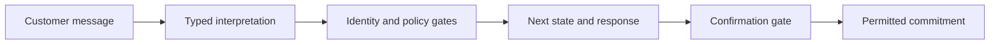

# Build within the existing application

Read the relevant modules from [project.md](project.md) before changing them.
Reuse the model adapters, persistence, and channel contracts.

## Prompts and outputs

- Separate system instructions from customer text. Treat customer text and tool
  output as data, never as a template or new operating instructions.
- For Jinja, resolve templates relative to their module, use `StrictUndefined`,
  and test representative renders and missing required fields. A dict key such
  as `items` can resolve to a method; prefer unambiguous access.
- Use typed output when code consumes amounts, dates, intents, or decisions.
  Validate meaning against authoritative data as well as validating the schema.
- Keep identity verification, allowed terms, contact permissions, and explicit
  confirmation in code. A prompt is not an enforcement mechanism.

## Tools and side effects

- Give each tool a precise purpose, typed arguments, accepted values, and a
  bounded result. Return expected domain failures as structured data; do not
  turn unexpected failures into successful answers.
- Bound external calls with timeouts. Keep credentials in the existing
  configuration path and avoid exposing raw remote response bodies.
- Default new exploratory tools to read-only. Preserve authorized local
  commitment writes and their confirmation, idempotency, and transaction gates.
  Real messages, payment actions, and production connections require separate
  task authorization; they are not implied by a simulation.
- Enforce mandatory lookups in code. Forcing the same tool choice on every
  model iteration can prevent a tool loop from ever answering.

## Memory and state

- Separate transport thread/checkpoint metadata from verified business identity.
  The backend owns identity and runtime context; customer text cannot supply it.
- Isolate sessions and customers through the existing service/repository contract.
  A repeated event must not create a second agreement.
- Revalidate mutable facts before committing. Memory does not prove that a
  balance, permission, or offer is still current.
- Test recovery and stale offers using temporary databases. Do not delete the
  user's database or change storage engines to make a test pass.

This illustrates control responsibilities, not the exact runtime graph. Read
the current graph and tests before documenting implemented transitions.

## Retrieval, only when requested

Distinguish mutable balances and permissions from explanatory documents. For a
new retrieval feature, decide corpus, source/page metadata, index ownership,
embeddings provider, and absent-answer behavior. Do not introduce it merely
because the course includes RAG examples.

Preserve source/page metadata and verify that citations were retrieved. Citation
validity alone does not prove a claim is supported. Include questions absent
from the corpus. Use stable chunk IDs and consistent embeddings for indexing
and querying. Never deserialize an untrusted pickle index.

A follow-up may need query rewriting before retrieval; adding history only to
the answer model does not fix the query. Measure a baseline before adding
multi-query retrieval. Label new retrieval capabilities as planned until tested.

## Evidence

Retain synthetic inputs, configuration, relevant state/tool outcomes, errors,
outputs, and observed usage under ignored `.validation/`. Keep credentials out
and tracing disabled unless authorized. Reuse existing test/receipt mechanisms;
the upstream `run_log.py` framework is not a local dependency.
