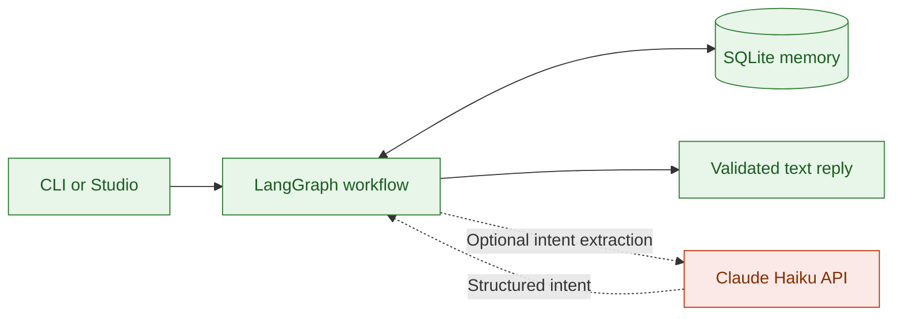
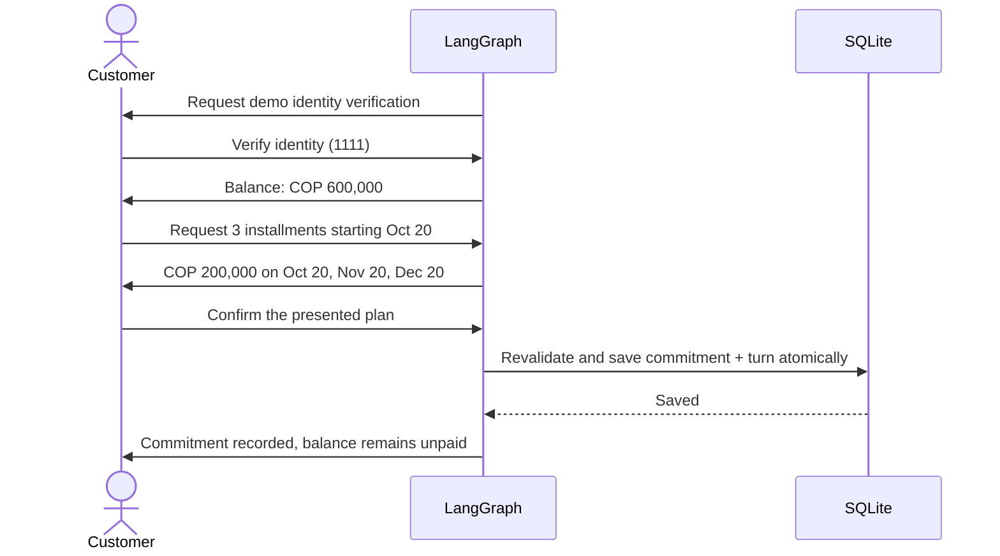
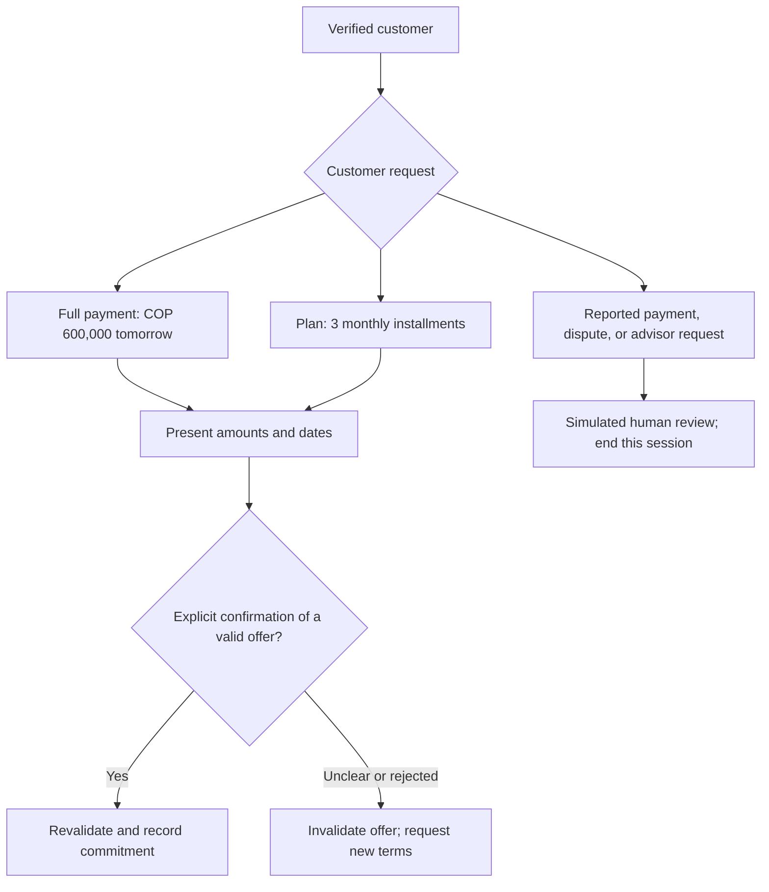
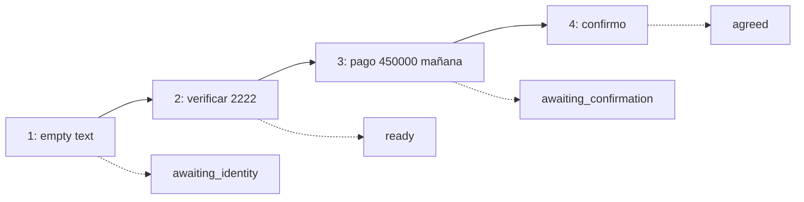

# AgenticDebtCollection

A conversational debt collection agent that negotiates payment plans and records commitments.
Built with LangGraph for a fictional Colombian fintech.

**Available now:** local text conversations through the CLI or LangGraph Studio, with SQLite memory.
Voice simulation and AWS deployment are [planned stages](docs/ROADMAP.md).



Green runs locally. Orange is an optional paid API. The default `mock` provider uses a limited,
offline Spanish parser; code calculates amounts, enforces policy, and composes replies in both modes.

## Run a conversation

Requires Python 3.12 and [uv](https://docs.astral.sh/uv/).

```bash
uv sync --locked
cp -n .env.example .env
uv run collections-lab chat --database .local/quickstart.sqlite3 --session quickstart --provider mock
```

Type the following. Customer messages stay in Spanish to match the Colombia demo.

```text
verificar 1111
quiero 3 cuotas desde 2026-10-20
confirmo
```



```bash
uv run collections-lab agreements --database .local/quickstart.sqlite3
uv run collections-lab fixtures
uv run collections-lab graph
```

- **Fixed demo clock:** October 19, 2026, 09:00, America/Bogota. Override with `--at`.
- **Fixtures:** `demo-001`: COP 600,000 / code `1111`; `demo-002`: COP 450,000 / code `2222`.
- **Fresh scenario:** choose a new database file. Reusing an account on the same day can trigger the contact limit.
- **Resume:** reuse the session and database. `/salir` exits the CLI; `terminar` closes the session. Finished sessions stay closed.

Identity codes are test data, not customer authentication. This local demo uses synthetic debts;
it is not ready for public access or a real collections pilot.

## Explore the examples

After identity verification, choose a path. A payment commitment never marks the debt as paid.



| Example | Type after verification | Result |
| --- | --- | --- |
| Full payment | `pago 600000 mañana` → `confirmo` | One commitment for October 20 |
| Payment plan | `quiero 3 cuotas desde 2026-10-20` → `confirmo` | Three monthly installments |
| Reported payment | `ya pagué` | Human review; no payment recorded |
| Disputed debt | `no reconozco la deuda` | Human review; negotiation stops |
| Advisor | `quiero un asesor` | Simulated handoff |
| End conversation | `terminar` | Session closes |

The mock parser is deliberately limited. An unclear reply invalidates the pending offer;
a later bare confirmation cannot accept it. Present new terms first.

## Inspect each turn in Studio

```bash
uv run langgraph dev
```

Select `collections_agent`, create one Studio thread for the session, and start with:

```json
{"session_id":"studio-001","account_id":"demo-002","event_id":"1","text":""}
```

Keep the session and account IDs; change the event ID and text for each turn:



SQLite is the business source of truth; Studio manages development checkpoints.
Use the four public input fields above, not internal state. The default database is
`.local/collections.sqlite3`; independent scenarios need separate database files.

## Optional Haiku extraction

Set your own `ANTHROPIC_API_KEY` in the local `.env`, then run:

```bash
uv run collections-lab chat --database .local/haiku.sqlite3 --session haiku-001 --provider anthropic
```

This consumes tokens using `claude-haiku-4-5-20251001`. There is no automatic provider fallback.
Live Haiku calls have not been validated; tracing is disabled by default.

## Explore the repository

| Start here | What you will see |
| --- | --- |
| [Architecture](docs/ARCHITECTURE.md) | Exact graph, routing, storage, and policy boundaries |
| [Roadmap](docs/ROADMAP.md) | Text → simulated voice → staging → telephony |
| [Validation](docs/VALIDATION.md) | Reproducible turns and verified vs. pending checks |
| [Agent implementation](src/agents/collections) | Nodes, routes, fixtures, and policies |
| [Tests](tests/README.md) | Offline checks |
| [Attribution](NOTICE.md) | Structural and visual references |
