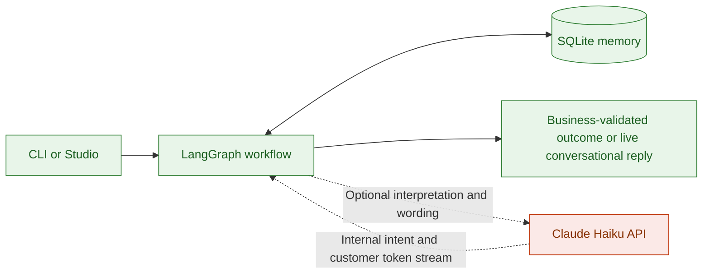
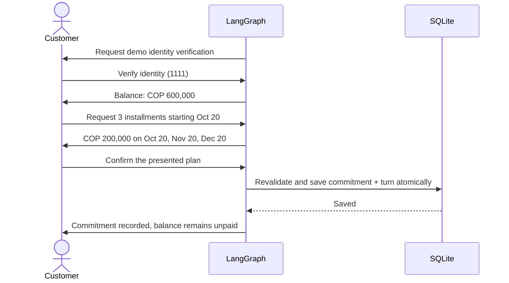
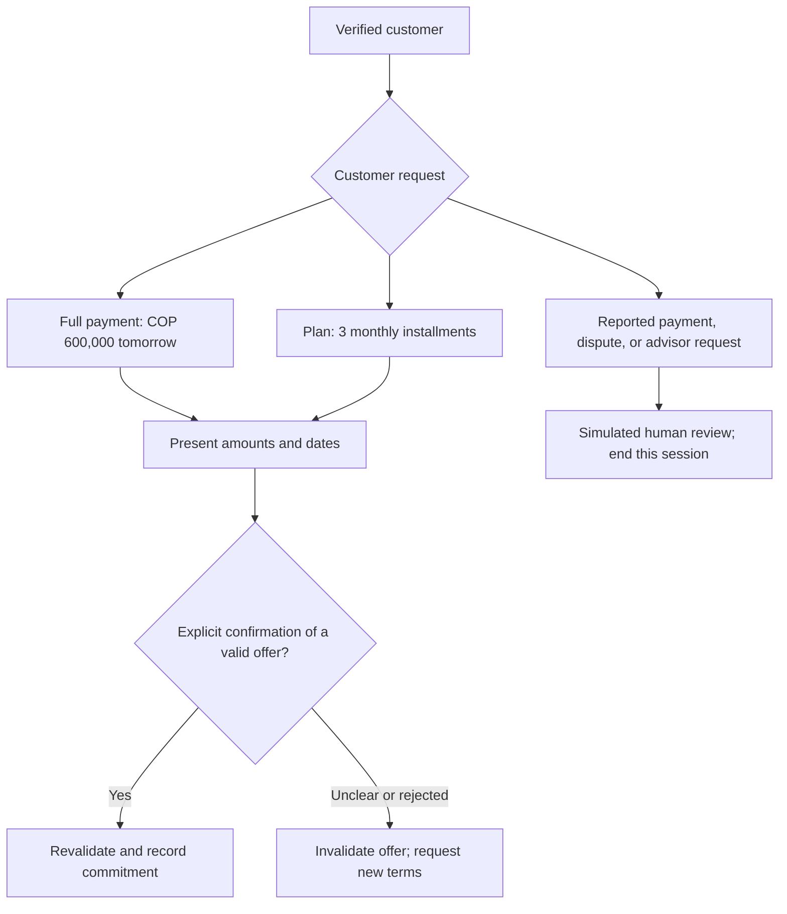
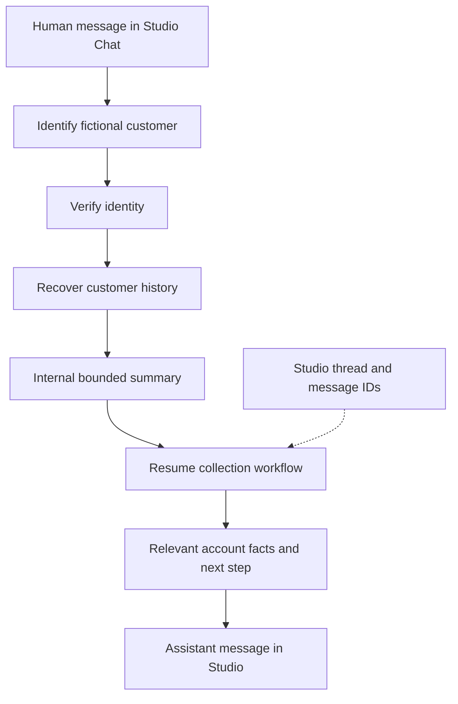

# AgenticDebtCollection

A conversational debt collection agent that negotiates payment plans and records commitments.
Built with LangGraph for a fictional Colombian fintech.

**Available now:** local text conversations through the CLI or LangGraph Studio, with SQLite memory.
Voice simulation and AWS deployment are [planned stages](docs/ROADMAP.md).



Green runs locally. Orange is an optional paid API. The default `mock` provider uses a limited,
offline Spanish parser. Code calculates amounts and enforces policy. With `anthropic`, Haiku
interprets context and streams conversational replies. Identity, offers and agreements remain
backend-validated. Set `COLLECTIONS_RESPONSE_MODE=reviewed` for whole-text review instead.
See [streaming behavior](docs/STREAMING.md).

## Run a conversation

Requires Python 3.12 and [uv](https://docs.astral.sh/uv/).

```bash
uv sync --locked
cp -n .env.example .env
uv run collections-lab chat --database .local/quickstart.sqlite3 --session quickstart --provider mock
```

Type the following. Customer messages stay in Spanish to match the Colombia demo.

```text
verificar 1111
quiero 3 cuotas desde 2026-10-20
confirmo
```



```bash
uv run collections-lab agreements --database .local/quickstart.sqlite3
uv run collections-lab fixtures
uv run collections-lab graph
```

- **Fixed demo clock:** October 19, 2026, 09:00, America/Bogota. Override with `--at`.
- **Fixtures:** `demo-001`: COP 600,000 / code `1111`; `demo-002`: COP 450,000 / code `2222`.
- **Fresh scenario:** choose a new database file. Reusing an account on the same day can trigger the contact limit.
- **Resume:** reuse the session and database. `/salir` exits the CLI; `terminar` closes the session. Finished sessions stay closed.

Identity codes are test data, not customer authentication. This local demo uses synthetic debts;
it is not ready for public access or a real collections pilot.

## Explore the examples

After identity verification, choose a path. A payment commitment never marks the debt as paid.



| Example | Type after verification | Result |
| --- | --- | --- |
| Full payment | `pago 600000 mañana` → `confirmo` | One commitment for October 20 |
| Payment plan | `quiero 3 cuotas desde 2026-10-20` → `confirmo` | Three monthly installments |
| Reported payment | `ya pagué` | Human review; no payment recorded |
| Disputed debt | `no reconozco la deuda` | Human review; negotiation stops |
| Advisor | `quiero un asesor` | Simulated handoff |
| End conversation | `terminar` | Session closes |

The mock parser is deliberately limited. An unclear reply invalidates the pending offer;
a later bare confirmation cannot accept it. Present new terms first.

## Inspect each turn in Studio

```bash
uv run langgraph dev
```

Select `collections_agent` → **Chat** → **New Thread**. Type human messages directly:

| Message | Agent behavior |
| --- | --- |
| `Hola` | Introduces itself as a virtual assistant and asks for identification |
| `Mi cédula es 1000000001` | Requests the scenario verification code |
| `1111` | Verifies the code, then recovers history and balance |
| `quiero 3 cuotas desde 2026-10-20` | Presents an installment proposal |
| `confirmo` | Saves one payment commitment |

**Tester setup — outside the customer dialogue:** this is a local simulation with synthetic
accounts, no real calls or payments. Use only these fixtures; never enter real personal data.
The agent stays in character as a virtual assistant and does not repeat testing instructions.

| Test customer ID | Verification code | Balance |
| --- | --- | --- |
| `1000000001` | `1111` | COP 600,000 |
| `1000000002` | `2222` | COP 450,000 |

Studio accepts the four-digit code directly; the older `verificar 1111` form still works.
These test codes do not represent production authentication.



Switch to **Graph** to inspect identity, memory, negotiation, and persistence nodes.
No session, account, or event IDs need to be entered. Studio supplies transport IDs;
the backend binds them to the verified customer and business conversation.

Open another thread and verify the same fictional identity to recover its history and
commitments. `¿Qué acordamos?` returns relevant account facts after verification: a pending
offer, recorded commitment, or next step. Transcript excerpts, internal status labels and
recovery messages never become customer replies. The internal summary is bounded to three
conversations and three commitments; original records remain intact. This uses no extra
LLM call. An ID alone never grants access to history.

A returning thread resumes the existing business conversation, including its pending
offer or terminal outcome; it does not initiate another outbound contact. New business
sessions still pass the existing contact controls. SQLite holds business records and
verified identity bindings; Studio holds message checkpoints. For independent scenarios,
use a separate database (`COLLECTIONS_DATABASE_PATH`).

## Haiku conversation mode

Set `COLLECTIONS_LLM_PROVIDER=anthropic` and your `ANTHROPIC_API_KEY` in local `.env`
for Studio. Restart `uv run langgraph dev` after changing configuration. For the CLI:

```bash
uv run collections-lab chat --database .local/haiku.sqlite3 --session haiku-001 --provider anthropic
```

This consumes tokens using `claude-haiku-4-5-20251001`. There is no automatic provider fallback.
Tracing is disabled by default. Interpretation can use the latest four persisted turns.
Wording and review receive only the backend's authorized response reference, without customer
history. Exact dates and confirmations, offer schedules, terminal replies, and agreement writes
remain deterministic. `wording_status` exposes `validated`, `deterministic`, `rejected`, or
`model_error`; rejected wording uses the reference after at most one regeneration.

## Explore the repository

| Start here | What you will see |
| --- | --- |
| [Negotiation](docs/NEGOTIATION.md) | Objections, affordable counteroffers, and the conversation loop |
| [Use cases](docs/USE_CASES.md) | Happy paths, failures, edge cases, evidence, and pending acceptance cases |
| [Local persistence](docs/LOCAL_STORAGE.md) | SQLite today, DynamoDB Local recommendation, and worktree lifecycle |
| [Architecture](docs/ARCHITECTURE.md) | Exact graph, routing, storage, and policy boundaries |
| [Roadmap](docs/ROADMAP.md) | Text → simulated voice → staging → telephony |
| [Validation](docs/VALIDATION.md) | Reproducible turns and verified vs. pending checks |
| [Agent implementation](src/agents/collections) | Nodes, routes, fixtures, and policies |
| [Tests](tests/README.md) | Offline checks |
| [Attribution](NOTICE.md) | Structural and visual references |
