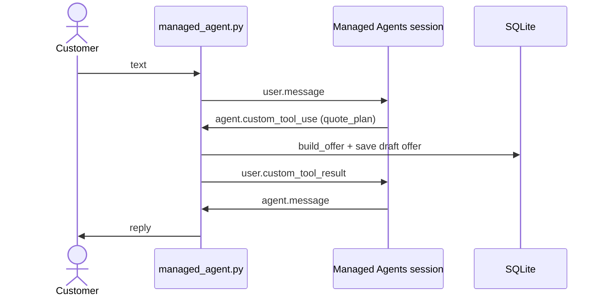

# negociador-cobranza

Managed Agents version of the collections negotiator. One Claude Managed Agents session holds one
text conversation with one fictional customer. The agent talks; the local backend
(`src/collections_lab/channels/managed_agent.py`) answers every identity, money and persistence
tool with the same domain code as the LangGraph workflow (`build_offer`, `validate_offer`,
`check_contact`, `save_confirmed_offer`).

- **Measured cost per conversation:** under USD 0.005 (2026-10-24, 5 turns, 11.7 s active; first turn about 6 s, later turns 1-2 s).
- **Not for voice:** each turn is a hosted agent round trip, measured in seconds.



## Run a conversation

```bash
uv run python -m collections_lab.channels.managed_agent --database .local/managed.sqlite3 --verbose
```

Requires `ANTHROPIC_API_KEY` (or `ant auth login`) and `claude-lock.json` at the repository root.
Customer messages stay in Spanish: `Hola` → `Mi cédula es 1000000001, código 1111` →
`quiero 3 cuotas desde 2026-10-20` → `confirmo`.

## Design sheet

```
AGENT  negociador-cobranza   (agents/negociador-cobranza/)

Model         claude-haiku-5-5 · effort low                 model.yaml
              why: cost and latency; misreading a conditional acceptance is
              blocked by the backend, not by the model
Trigger       a person: each conversation creates one session from managed_agent.py
              why: the customer starts; there is no schedule
Kickoff       user.message per turn · no rubric
              why: the prompt's Goal defines the four valid endings
Budget        USD 1 per conversation (amount "100") · tests USD 5 ("500")
              Haiku tokens + USD 0.08 per running hour (idle is free)
Sandbox       none (default_config.enabled: false)          tools.yaml
              why: the agent reads third-party text; bash/write only add risk
MCP, skills   none: the system of record is the local backend
Custom tools  collections_verify_identity      ID + code; three failures close
              collections_get_account_summary  balance, policy, saved agreement
              collections_quote_plan           build_offer -> exact installments + offer_id
              collections_record_commitment    latest offer, quoted in an earlier turn,
                                               exact quote of the latest customer message
                                               -> save_confirmed_offer
              collections_request_human_review queue in <db>.reviews.jsonl
              all answered by managed_agent.py
Subagents     none: one conversation, small context
Environment   cloud · limited network · no hosts · no MCP · no package managers
Memory        no memory store: agreements and contacts live in SQLite;
              a shared store would mix customers
Files, vault  none: policy comes from the account summary; no external services
Gate          the agent only proposes; record_commitment revalidates in code.
              Exceptions go to human review; nothing is charged or sent
Left out      voice (latency), discounts, payments, real outbound messages
```

## Limits

- **Acceptance meaning is prompt-dependent.** The backend proves that `confirmation_quote` is the
  customer's latest message, sent after the offer. It does not prove that the message is an
  unconditional acceptance ("acepto si me descuentan" passes the quote check). Keyword filters
  were rejected: "si, acepto" without an accent is a common yes.
- **Identity attempts are per session**, as in the LangGraph thread (ID-03). A new session gets three
  more attempts. This is acceptable only for the fictional demo codes.
- **One session per account per day.** Verification records a contact, so a second same-day session
  is refused by `check_contact`. The LangGraph flow resumes those cases (HP-06/HP-07); this channel
  does not yet. Leaving with `/salir` after verification still uses the day's contact.
- **Budget** is in cents of USD: `--budget-cents 100` is USD 1. Sessions stay idle after `/salir`;
  idle time is not billed.

## Files

| File | What it is |
|---|---|
| `model.yaml` | Name, description, model and effort |
| `system_prompt.md` | The system prompt, in Simplified Technical English |
| `tools.yaml` | Sandbox off, five custom tools |
| `environment.yaml` | The container: limited network, no hosts |
| `agent.md` | Generated by `scripts/ensamblar.py`. Do not edit by hand |

## Change something

```bash
uv run --script scripts/ensamblar.py agents/negociador-cobranza
F=(agents/negociador-cobranza/agent.md agents/negociador-cobranza/environment.yaml)
ant apply --dry-run -v "${F[@]}"
ant apply --yes "${F[@]}"   # only after reading the plan
```

## Debug

```bash
uv run --script scripts/trazas.py <session_id>        # what the session did, event by event
uv run --script scripts/inspeccionar.py <session_id>  # why it stopped
```

## IDs

| Resource | ID |
|---|---|
| agent.md | `agent_01Hsmomv5hurQo3XVkp6vwFV` (v1) |
| environment.yaml | `env_01W3Y4rHdpDCkS4z4ZejSJFB` |
