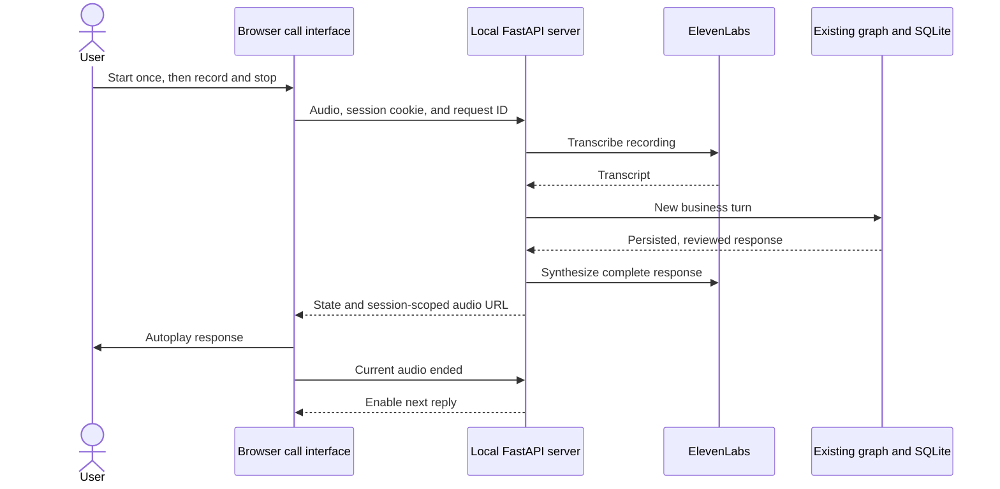

# Local voice simulator

A standalone HTML/CSS/JavaScript call interface talks to a same-origin FastAPI server.
The server reuses the existing conversational graph and ElevenLabs adapters; credentials
remain on the server. No frontend framework, asset CDN, or separate frontend build is required.
The interface uses translucent surfaces, a call timer, microphone/hangup controls, automatic
response playback, and an optional transcript with typed replies.



## Run

```bash
uv sync --locked --extra voice
cp -n .env.example .env
# Fill ELEVENLABS_API_KEY and ELEVENLABS_VOICE_ID locally.
uv run --extra voice collections-voice --provider mock
```

Open http://127.0.0.1:7860. Open the HTML through this server, not as a `file://` document.
The server binds only to loopback. Microphone capture requires browser permission.
The API key needs Text to Speech and Speech to Text access, and the voice must be
available to your account through the API. Defaults are `scribe_v2` and
`eleven_multilingual_v2`. There are no automatic charged retries.

For interpretation with Claude Haiku, set `ANTHROPIC_API_KEY` and run:

```bash
uv run --extra voice collections-voice --provider anthropic
```

`mock` uses no LLM, but speech still consumes ElevenLabs credits. Complete responses pass
the existing business checks before synthesis; speculative tokens are never spoken.

## Try a conversation

1. Click **Iniciar llamada**. The greeting plays automatically.
2. When **Es tu turno** appears, click the microphone, speak, then click it again to send.
   Transcription, sending, and response playback happen automatically.
3. Say `Mi cédula es 123456789`, then `verificar 1111`.
4. Request `quiero 3 cuotas desde 2026-10-20`.
5. Wait for the proposal audio to finish, then say `confirmo`.

The red **Colgar** button ends the conversation, stops browser audio/capture, and avoids
an extra synthesized goodbye. **Ver conversación o escribir** expands the transcript and
text fallback; Enter sends. Recordings stop at 60 seconds and are limited to 10 MB.

The fictional ID `123456789` aliases `1000000001`, selecting `demo-001`, code `1111`,
and initial balance COP 600,000. It is not a separate customer or debt. The second fixture
uses `1000000002` and code `2222`. The demo clock is October 19, 2026, America/Bogota.
A saved commitment never marks a debt as paid.

## API and recovery

| Route | Purpose |
| --- | --- |
| `GET /api/trace` | Read bounded, sanitized graph execution events without blocking the current turn |
| `GET /api/session` | Restore current call, transcript, playback state, and elapsed time |
| `POST /api/start` | Begin an isolated conversation |
| `POST /api/text` | Send a JSON `text` reply |
| `POST /api/recording` | Transcribe raw WebM, Ogg, MP4, or WAV and send one turn |
| `GET /api/audio/{audio_id}` | Read the current audio belonging to this browser session |
| `POST /api/playback` | Acknowledge completion of the current `audio_id` |
| `POST /api/retry` | Regenerate current response audio without repeating the business turn |
| `POST /api/end` | End the current conversation |

The page establishes an HttpOnly, SameSite=Strict session cookie. Mutations require
`X-Voice-Client: 1`, a UUID `X-Request-ID`, and (except start) the current `X-Call-ID`.
Foreign browser origins and unknown hosts are rejected. Responses expose audio IDs, not
filesystem paths. Calls serialize per browser session. The latest 128 request IDs and
results are cached in memory, including uncertain failures; replaying the same request
within this window avoids duplicate provider calls and business writes.

- If autoplay is blocked, **Escuchar mensaje** starts playback. Only the current audio's
  ended event unlocks the next reply; stale events cannot unlock a regenerated offer.
- **Reintentar audio** only synthesizes the saved response. An offer with failed audio
  blocks negotiation until synthesis and playback succeed. Hanging up remains available.
- Transcription errors leave the business turn unchanged. Record again or use typed input.
- A network failure offers an explicit retry with the original request ID and payload.
  A pending reply arriving after hangup cannot restart browser playback.
- Refreshing restores the current call and timer while the server and session remain alive.
  An unplayed response offers manual playback after reload. Tabs sharing the cookie share
  the same call. Sessions expire after one hour; server restart clears browser sessions.
- Each call has isolated SQLite state, response MP3s, and playback-event evidence under
  ignored `.local/voice/<id>/`. Uploaded recording files are removed after transcription;
  saved response audio and business evidence remain on disk.
- `.env` is local to each worktree. Git only distributes `.env.example`.

## Optional technical viewer

**Ver flujo técnico** opens a panel next to the call on wide screens, or below it on
narrow screens. It starts hidden on every page load. Closing it, pressing Escape inside
it, or using the same toggle returns to the call-only layout without interrupting audio.

The graph topology comes from the compiled graph, including conditional edges. Node
positions are presentation-only; new node names receive fallback positions. LangGraph
`tasks` events supply actual node starts/completions/errors; the voice adapter records
STT/TTS separately. Fast nodes may complete between refreshes, but their executed path
and measured durations remain visible. Select a node or expand an event for updated
state field names. The viewer does not expose raw inputs, state values, prompts,
identification data, provider exceptions, or model reasoning.

`GET /api/trace` reads an independent lock so a running business turn does not block it.
The browser polls every 500 ms only while the panel is open, with one request in flight,
a timeout, and cancellation when closed. Reading the viewer never invokes the agent or
speech provider. The latest turn retains up to 200 events in memory; starting another
turn clears the previous trace. Audio retries append speech events without rerunning nodes.
This is execution visibility, not Studio debugging, checkpoint editing, or audio streaming.

## Boundaries

This is a local demo API, not a production authentication boundary or telephone service.
Browser-ended events do not prove audibility or attention. Continuous listening, barge-in,
stronger playback tracking, production authentication, and telephony remain planned.
Streaming remains a TODO, including its Free-plan endpoint/credit validation. Only audio
and text needed for speech are sent to ElevenLabs. Use fictional data.

## Verification

`uv run --extra voice pytest -q` passes 300 tests. Voice tests use fake speech and mock HTTP
transport without paid calls. They cover provider request shape, redacted errors, automatic
transcription/send, offer playback gating, retries without duplicate agreements, session/audio
isolation, request replay, stale call IDs, origin/size checks, reload timing, uncertain failures, and live trace reads during a blocked node. Trace tests
also cover graph topology, redaction, session isolation, provider/node failures, and retries.
Ruff, JavaScript syntax, lockfile validation, and wheel construction also pass.

Chrome verification with previously generated audio covers greeting/reply autoplay, enabling
reply controls after playback, Enter-to-send, session reload, and hangup. The cached audio is
a UI test double, not a validation of newly generated speech content. Responsive layout is
checked at desktop and mobile widths. The technical viewer is checked for its default
hidden state, show/hide controls, execution highlighting, and expandable event details. Physical microphone capture still needs manual acceptance.

Earlier live adapter validation confirmed TTS MP3 generation with the configured designed
voice and Scribe v2 transcription of `Quiero tres cuotas desde mañana`. In the earlier UI,
that transcript produced three COP 200,000 installments; confirmation before playback was
rejected and completion saved exactly one unpaid commitment. This is adapter/business-flow
evidence, not a physical microphone test of the new frontend. Keep live evidence under
ignored `.validation/`.

[Roadmap](../../docs/ROADMAP.md) · [Validation](../../docs/VALIDATION.md)
