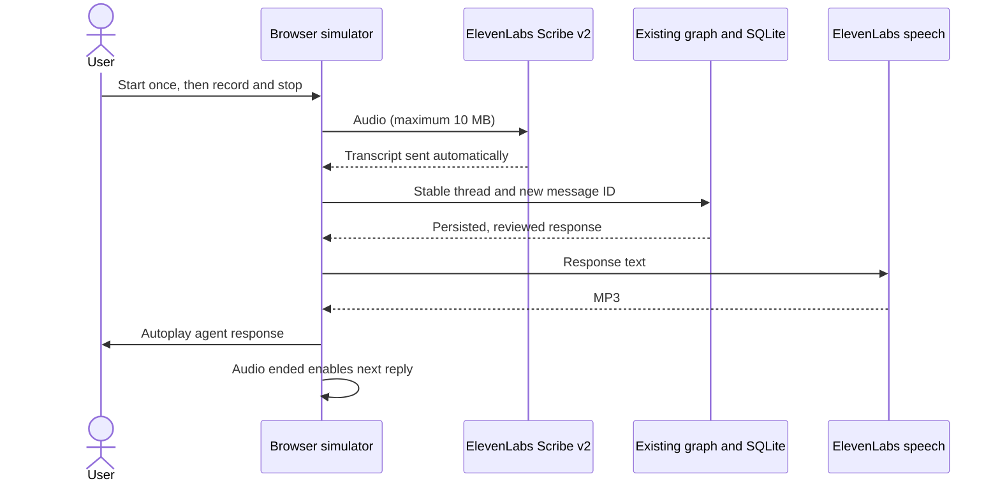

# Local voice simulator

A local Gradio application wraps the existing conversational graph with ElevenLabs.
It uses push-to-talk turns and synthetic customer fixtures, without dialing telephone numbers.



## Run

```bash
uv sync --locked --extra voice
cp -n .env.example .env
# Fill ELEVENLABS_API_KEY and ELEVENLABS_VOICE_ID locally.
uv run --extra voice collections-voice --provider mock
```

Open http://127.0.0.1:7860. The server binds only to loopback and disables public sharing.
The API key needs Text to Speech and Speech to Text access. The voice must be accessible
through the API for your account. The default speech models are `scribe_v2` and
`eleven_multilingual_v2`. There are no automatic charged retries.

For conversational interpretation with Claude Haiku, also set `ANTHROPIC_API_KEY` and run:

```bash
uv run --extra voice collections-voice --provider anthropic
```

Haiku uses the existing bounded interpretation and reviewed wording flow. Speculative
streaming tokens are not spoken. `mock` uses no LLM, but speech still consumes ElevenLabs credits.

## Try a conversation

1. Click **Iniciar conversación** once. The agent greeting plays automatically.
2. When **Responder** appears, record your answer and stop. Transcription and sending
   happen automatically; no transcript approval or send button is required.
3. Identify with `Mi cédula es 1000000001`, then `verificar 1111`.
4. Request `quiero 3 cuotas desde 2026-10-20`.
5. Wait for the proposal audio to finish, then record `confirmo`.

**Opciones** contains typed input (Enter sends), audio file input (upload sends),
audio retry, and conversation termination. The conversation transcript remains visible.

The second fixture uses `1000000002` and code `2222`. The default demo clock remains
October 19, 2026, America/Bogota. A saved commitment never marks a debt as paid.

## Recovery and local state

- Responses play automatically. If browser autoplay is blocked, press play once on the
  agent player. The reply control appears after playback ends; pausing does not unlock it.
- A failed speech request leaves the text and business turn saved. **Reintentar audio**
  regenerates only the latest audio, never the agreement or business turn.
- An offer with failed audio blocks negotiation until audio generation and playback succeed.
- Playback completion resets for every response and audio regeneration. The server rejects
  stale audio events and blocks subsequent offer turns, including renegotiation.
  **Terminar conversación** in **Opciones** remains available without playback completion.
- Transcription errors leave the business turn unchanged; record again or use typed input.
- Each new session has an isolated SQLite database and response MP3s in `.local/voice/<id>/`.
  Playback-ended events record the response/audio IDs in that directory. Files stay local and ignored.
- Browser session handles expire after one hour; refreshing starts a new UI session.
  Old local evidence remains on disk. There is no browser resume feature yet.
- `.env` is local to each worktree. Git only distributes `.env.example`; never commit credentials.

## Boundaries

This is a single-user local demo. Browser-ended events are tied to the current audio, but
do not prove that audio was audible or listened to without seeking. Continuous listening,
barge-in, stronger playback tracking, authentication, and production telephony are planned.
Streaming remains a TODO; each complete response is validated before speech generation.
Only the audio and response text needed for speech are sent to ElevenLabs. Use fictional data.

[Roadmap](../../docs/ROADMAP.md) · [Validation](../../docs/VALIDATION.md)
