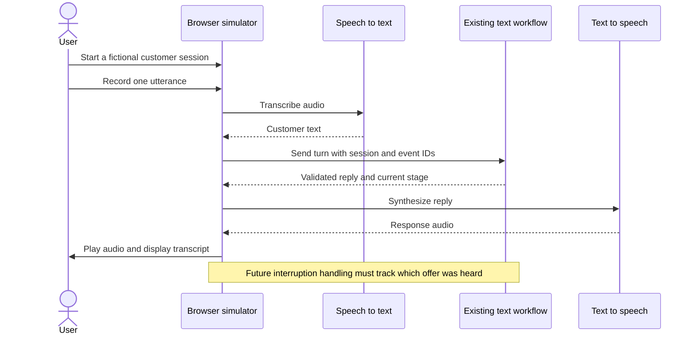

# Local voice simulator

**Stage 2: planned.** A Gradio interface will simulate a conversation in the browser without dialing a phone number.

| First version | Later iteration |
| --- | --- |
| Select fixture, start, record, mute, end | Streaming and pause detection |
| Manual turns and transcript panel | Cancel interrupted audio |
| Show offer, commitment, and latency | Validate offer playback before confirmation |

Speech adapters stay outside the financial workflow. Keep the business `session_id` stable;
if using Agent Server, map it to a development thread. No Gradio, STT, or TTS integration is installed yet.

[Delivery stages](../../docs/ROADMAP.md) · [Current architecture](../../docs/ARCHITECTURE.md)
