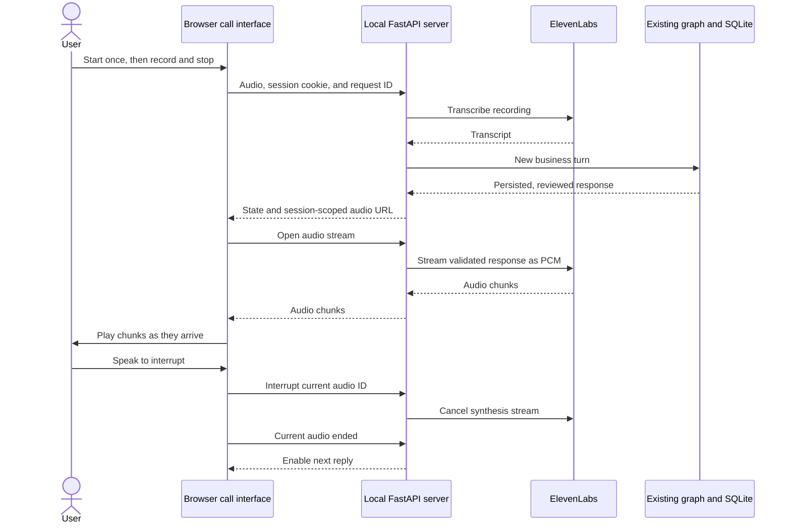

# Local voice simulator

A standalone HTML/CSS/JavaScript call interface talks to a same-origin FastAPI server.
The server reuses the existing conversational graph and ElevenLabs adapters; credentials
remain on the server. No frontend framework, asset CDN, or separate frontend build is required.
The interface uses translucent surfaces, a call timer, microphone/hangup controls, automatic
response playback, and an optional transcript with typed replies.
**Vista Glass** toggles a dark blue/green glass appearance while keeping the same call,
transcript, and optional technical viewer. The original light view is the default. The choice
is saved in browser local storage when available; changing it never restarts the call.



## Run

```bash
uv sync --locked --extra voice
cp -n .env.example .env
# Fill ELEVENLABS_API_KEY and ELEVENLABS_VOICE_ID locally.
uv run --extra voice collections-voice --provider mock
```

Open http://127.0.0.1:7860. Open the HTML through this server, not as a `file://` document.
The server binds only to loopback. Microphone capture requires browser permission.
The API key needs Text to Speech and Speech to Text access, and the voice must be
available to your account through the API. Defaults are `scribe_v2` and
`eleven_multilingual_v2` with mono 24 kHz signed 16-bit PCM over the
[ElevenLabs streaming endpoint](https://elevenlabs.io/docs/api-reference/text-to-speech/stream).
The browser receives the complete PCM recording, wraps it losslessly in a mono WAV header,
and plays it through the native audio element, matching the accepted B sample. It adds no
tones, silence, or per-frame scheduling. Playback waits for the complete download.
There are no automatic charged retries. The legacy synchronous adapter still produces MP3.
Both speech paths render `COP` as `pesos` (`1 COP` as `1 peso`) only in the provider request:
`600,000 COP` stays written in the conversation while speech receives `600000 pesos`.
Grouping separators in currency amounts are removed for Spanish pronunciation. Persisted
responses, transcripts, and business amounts retain their original representation.

For interpretation with Claude Haiku, set `ANTHROPIC_API_KEY` and run:

```bash
uv run --extra voice collections-voice --provider anthropic
```

`mock` uses no LLM, but speech still consumes ElevenLabs credits. Complete responses pass
the existing business checks before synthesis; speculative tokens are never spoken.

## Try a conversation

1. Click **Iniciar llamada**. The greeting plays automatically.
2. Allow microphone access. Speak when ready, including while the agent speaks: sustained
   microphone activity pauses native playback immediately. Hanging up also cancels a pending
   audio download.
   About 900 ms of silence sends the recording; **Responder** / **Enviar** remain available.
   Use headphones to reduce echo. With permission denied, use the text fallback.
3. Say `Mi cédula es 123456789`, then `verificar 1111`.
4. Request `quiero 3 cuotas desde 2026-10-20`.
5. Wait for the proposal audio to finish, then say `confirmo`.

The red **Colgar** button ends the conversation, stops browser audio/capture, and avoids
an extra synthesized goodbye. **Ver conversación o escribir** expands the transcript and
text fallback; Enter sends. Recordings stop at 60 seconds and are limited to 10 MB.
The microphone stays active during the call after permission; hangup and page exit release it.
Detection uses a local amplitude threshold with 120 ms of sustained activity. It is a demo
voice detector, not speaker identification: loud background noise or echo may interrupt.
Capture starts before detection so short utterances such as `uno` retain their initial sound.

Supported Spanish cardinals are normalized before display and interpretation: `uno` → `1`,
`doscientos mil pesos` → `200000 pesos`, and `1,5 millones` → `1500000`. During identification,
dictated digits such as `cero cero uno uno` become `0011`, preserving leading zeroes.
Comma-separated lists of at least three single digits are also joined in identity stages:
`1, 2, 3, 4, 5, 6, 7, 8, 9` becomes `123456789`. An extra `10` is not discarded or
silently corrected to the demo ID. The demo ID and verification code stay visible below the call.
Articles such as `una persona` remain prose. Unsupported/ambiguous expressions are preserved;
this cannot repair an incorrectly recognized word. Pydantic structured output separately
requires strict integer amounts/counts and quoted numeric evidence from the current message.
Backend normalization checks the whole expression, preventing a model from treating `250 mil`
as `250` or selecting only `mil`. Invalid results request clarification without creating terms.

The fictional ID `123456789` aliases `1000000001`, selecting `demo-001`, code `1111`,
and initial balance COP 600,000. It is not a separate customer or debt. The second fixture
uses `1000000002` and code `2222`. The demo clock is October 19, 2026, America/Bogota.
A saved commitment never marks a debt as paid.

## API and recovery

| Route | Purpose |
| --- | --- |
| `GET /api/graphs` | Inspect registered graph maps, source version, and pending/invalid changes |
| `GET /api/trace` | Read bounded, sanitized graph execution events without blocking the current turn |
| `GET /api/session` | Restore current call, transcript, playback state, and elapsed time |
| `POST /api/start` | Begin an isolated conversation |
| `POST /api/text` | Send a JSON `text` reply |
| `POST /api/recording` | Transcribe raw WebM, Ogg, MP4, or WAV and send one turn |
| `GET /api/audio/{audio_id}` | Read the current audio belonging to this browser session |
| `POST /api/playback` | Acknowledge completion of the current `audio_id` |
| `POST /api/interrupt` | Stop current synthesis without marking the offer as heard |
| `POST /api/retry` | Regenerate current response audio without repeating the business turn |
| `POST /api/end` | End the current conversation |

The page establishes an HttpOnly, SameSite=Strict session cookie scoped by server port.
Authenticated requests renew its one-hour expiry. Mutations require
`X-Voice-Client: 1`, a UUID `X-Request-ID`, and (except start) the current `X-Call-ID`.
Foreign browser origins and unknown hosts are rejected. Responses expose audio IDs, not
filesystem paths. Calls serialize per browser session. The latest 128 request IDs and
results are cached in memory, including uncertain failures; replaying the same request
within this window avoids duplicate provider calls and business writes.

- Completed audio can be replayed without another synthesis request. A failed, interrupted,
  or concurrent stream cannot start a second charged request; use **Reintentar audio** explicitly.
  `tts_first_chunk_seconds` measures time to the provider's first chunk, separately from total TTS.
- Interruptions unlock a new reply, including a counteroffer or request to stop. They never
  mark the offer heard. The backend confirmation node re-presents an unheard offer in full
  instead of committing it, explains why, and waits for a new acceptance after playback;
  confirmation requires a completed stream and playback acknowledgment for the current audio.
  Stale playback events cannot unlock a regenerated offer.
- **Reintentar audio** only synthesizes the saved response. An offer with failed audio
  blocks negotiation until synthesis and playback succeed. Hanging up remains available.
- Transcription errors leave the business turn unchanged. Record again or use typed input.
- A network failure offers an explicit retry with the original request ID and payload.
  A pending reply arriving after hangup cannot restart browser playback.
- Refreshing restores the current call and timer while the server and session remain alive.
  An unplayed response offers manual playback after reload. Tabs sharing the cookie share
  the same call. Sessions expire after one hour of inactivity; server restart clears browser sessions.
  During a running turn, session/audio reads return the last published state immediately;
  the page displays a busy state and polls recovery until the turn completes.
- A failed graph turn is quarantined: finish the call before starting another. Unexpected
  errors are redacted; only dedicated input/provider errors carry user-facing messages.
  SQLite rolls back a failed graph transaction and already enforces one agreement per session.
  A greeting that fails during speech remains reachable for audio retry.
- Each call has isolated SQLite state, completed response PCM, and playback-event evidence under
  ignored `.local/voice/<id>/`. Uploaded recording files are removed after transcription;
  saved response audio and business evidence remain on disk.
- `.env` is local to each worktree. Git only distributes `.env.example`.

## Optional technical viewer

**Ver flujo técnico** opens a panel next to the call on wide screens, or below it on
narrow screens. It starts hidden on every page load. Closing it, pressing Escape inside
it, or using the same toggle returns to the call-only layout without interrupting audio.

The graph topology comes from the compiled graph, including conditional edges. A layered
layout computes every position and canvas bound from that topology; renamed/new nodes,
branches, cycles, and different terminal nodes require no HTML edits. LangGraph debug task
lifecycle events provide supersteps, starts, completions, and errors. Only observed nodes and
compatible topology edges from the preceding superstep are highlighted; ambiguous conditional
fan-in is deliberately not asserted as a transition. STT/TTS events appear separately.
Fast nodes may finish between refreshes, but their durations remain visible.

When launched from a checkout, `collections-voice` discovers compiled graph references in
`langgraph.json` (`./src/package/file.py:agent` or `package.module:agent`). Entries must live
under that checkout's `src/`; runtime factories and external modules are not supported.
The **Mapa** selector distinguishes the current call from read-only maps of registered graphs.
Browsing another map never changes the graph executing the call. Voice calls continue using
`collections_agent` and its messages/reply contract; an unrelated graph needs a voice adapter
before it can drive a call.

The registry fingerprints local Python source, Jinja templates (`.jinja`/`.jinja2`), and the manifest. Changes are loaded automatically
on the next catalog read or call start when no calls hold the current graph version. Active calls
keep their loaded graph, and the viewer reports pending updates. A syntax/import error preserves
the last valid catalog and reports a sanitized warning. The next corrected source version is
retried. Imports compile source directly without modifying bytecode caches. Graph entry modules
must only define/compile graphs, as in Studio; never put provider calls at module import time.

Calls keep their lease even between turns so a reload cannot mix module versions within a
conversation. Close calls with Hang up before expecting a pending edit to load. Closing a tab
without hanging up retains its lease until the session expires after one hour of inactivity;
other active sessions can also defer reload. Shorter abandoned-call expiry remains a follow-up.
Reloading merely because no turn is busy would violate this per-call version guarantee.

The fingerprint excludes JSON fixtures and policy data; their call-time reads do not trigger a
pending-source notice. Catalog polls currently hash local source and templates while holding the registry lock.
Incremental change detection and background catalog preparation are performance follow-ups.
The voice turn uses a thread-local SQLite transaction. Repository-writing nodes must execute
serially on the turn thread; parallel graph branches may be visualized but must not access this
repository until transaction propagation across workers has been designed and tested.

This watches the current checkout, not GitHub: integrating/pulling other PRs remains explicit.
Once their source is present here, graph changes need no manual diagram updates or server restart.
Changes to the server itself, dependencies, or environment still require restart. Without a local
manifest, the packaged demo uses its built-in graph and does not hot reload.

`GET /api/trace` reads an independent lock so a running business turn does not block it.
The browser polls trace/catalog every 500 ms only while the panel is open, with one poll cycle
in flight, timeouts, and cancellation when closed. Observation never runs a graph turn or speech
request. The latest turn retains up to 200 events; another turn clears the previous trace.
Audio retries append only speech events. Node details expose updated field names, not raw state,
identification data, prompts, provider exceptions, or model reasoning. Subgraphs are represented
by their parent node; this does not expand their internal execution or implement Studio debugging.

## Boundaries

This is a local demo API, not a production authentication boundary or telephone service.
Browser playback events do not prove audibility or attention. Stronger playback tracking,
production authentication, and telephony remain planned. Scribe transcription still uploads
a completed bounded recording. TTS streams to the server/browser cache, but native WAV
playback begins only after the complete response; this does not stream audible playback,
STT, or speculative LLM tokens.
Streaming cancels audio generation/delivery, not an already persisted graph turn. Plan-specific
endpoint/credit availability and physical microphone/echo performance require live acceptance.
Only audio and text needed for speech are sent to ElevenLabs. Use fictional data.

## Verification

`uv run --extra voice pytest -q` runs the offline suite. Voice tests use fake speech and mock HTTP
transport without paid calls. They cover provider request shape, redacted errors, automatic
transcription/send, offer playback gating, retries without duplicate agreements, session/audio
isolation, request replay, stale call IDs, origin/size checks, reload timing, uncertain failures, and live trace reads during a blocked node. Trace tests
also cover automatic layout, parallel branches, cycles, renamed terminal nodes, catalog discovery,
source reload deferred during active calls, invalid-edit recovery, session isolation, failed-start
recovery, non-blocking reads, error redaction, transaction rollback, and graph-turn quarantine.
Ruff, JavaScript syntax, lockfile validation, and wheel construction also pass.
The browser state-machine regression uses Node when available and exercises complete-download
WAV playback, odd-byte network boundaries, exact PCM sample preservation without a prefix,
speech interruption, download cancellation, recording pre-roll, and acknowledgment only after
the native audio element fires `ended`. It also covers microphone setup/denial, autoplay
recovery, and object URL cleanup. API tests cover partial streams, explicit retries, cancellation
cleanup, and interrupted-offer acceptance protection.
The user requested the same full-file native playback as the Multilingual v2 B sample after
fragmented playback, added silence, and a diagnostic tone did not resolve audible clipping.
The source model and playback mechanism now match that sample; physical acceptance of the
updated simulator remains necessary. No diagnostic tone is included in the application.
Initial playback waits for pending microphone setup (grant or denial) to settle. The wait is
cancellable by hanging up, and denying the microphone retains typed replies.
Partial provider failures abort the HTTP body, so the browser rejects incomplete audio without
acknowledging a truncated offer. Numeric evidence accepts accent/Unicode variants while
still rejecting partial numeric expressions and ranges such as `2-3` as one exact count.

Follow-ups: replace the bounded arm-time recording with a codec-safe rolling pre-roll buffer
to avoid uploading idle silence; calibrate echo/noise thresholds on physical devices; and
move PCM cache writes off the event loop if concurrent-call measurements justify it.
Also consolidate the proposal formatter shared in wording by negotiation and confirmation;
the replay regression currently checks that the complete original proposal is retained.
Courtesy idiom exemptions are narrow: other cardinal expressions such as `mil veces` become
`1000 veces`. In identity stages, whitespace-separated single digits are treated as dictation
(`1 2` → `12`); ambiguous mixed forms such as `doce tres` remain unchanged. Clearing obsolete
offer playback metadata after a business decline is a cleanup follow-up; it grants no authority.

Live adapter validation for this change synthesized `Uno.` through the PCM endpoint and
transcribed it as `1`. Claude Haiku returned validated numeric fields for one installment,
one peso per month, and two hundred thousand pesos per month. This verifies provider
compatibility for the configured account, not a latency benchmark or physical microphone test.

Chrome verification with previously generated audio covers greeting/reply autoplay, enabling
reply controls after playback, Enter-to-send, session reload, and hangup. The cached audio is
a UI test double, not a validation of newly generated speech content. Responsive layout is
checked at desktop and mobile widths. The technical viewer is checked for its default
hidden state, show/hide controls, execution highlighting, and expandable event details. Physical microphone capture still needs manual acceptance.

Earlier live adapter validation confirmed TTS MP3 generation with the configured designed
voice and Scribe v2 transcription of `Quiero tres cuotas desde mañana`. In the earlier UI,
that transcript produced three COP 200,000 installments; confirmation before playback was
rejected and completion saved exactly one unpaid commitment. This is adapter/business-flow
evidence, not a physical microphone test of the new frontend. Keep live evidence under
ignored `.validation/`.

[Roadmap](../../docs/ROADMAP.md) · [Validation](../../docs/VALIDATION.md)

### Semantic workflow compatibility

Each submitted human turn follows the registered graph's `understand_message` and
`route_chat_message` nodes. Voice does not run a second intent classifier. Playback gating
applies to an unheard offer, identified by `awaiting_confirmation` or a nonempty `offer_id`.
Explicit interruption allows new text/audio turns while the backend keeps acceptance disabled
until a complete offer has played.
Hang up closes only the local voice transport without inventing a customer utterance,
calling the model, or writing a payment agreement. It releases the graph lease even when
interpretation is unavailable. It does not change the persisted business outcome.
The graph's terminal `finished` replies still end the voice call. Customer-led continuation
after a closed collection outcome is available through the text workflow; resuming the same
business session across separate voice calls remains unsupported by this isolated demo.

- [ ] **TODO:** Resume the same business session across separate voice calls after fresh
  identity verification and an explicit customer request, preserving history and avoiding
  duplicate agreements. See the [roadmap](../../docs/ROADMAP.md#todo-resume-a-business-session-across-voice-calls).
