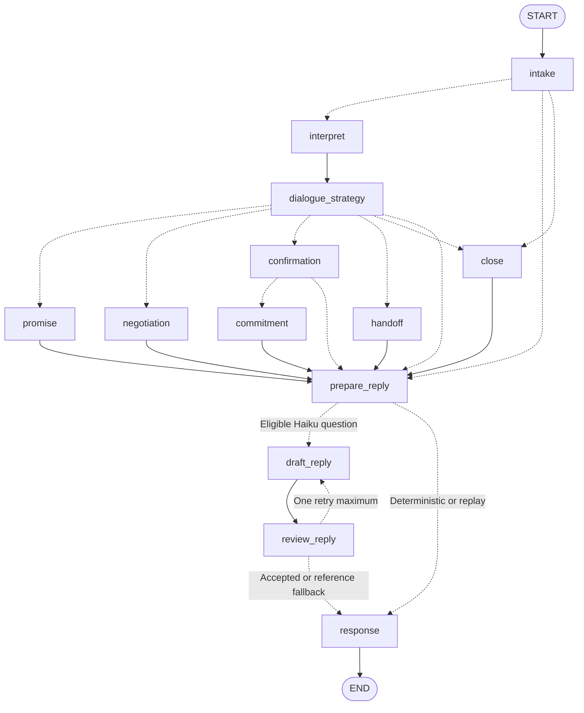
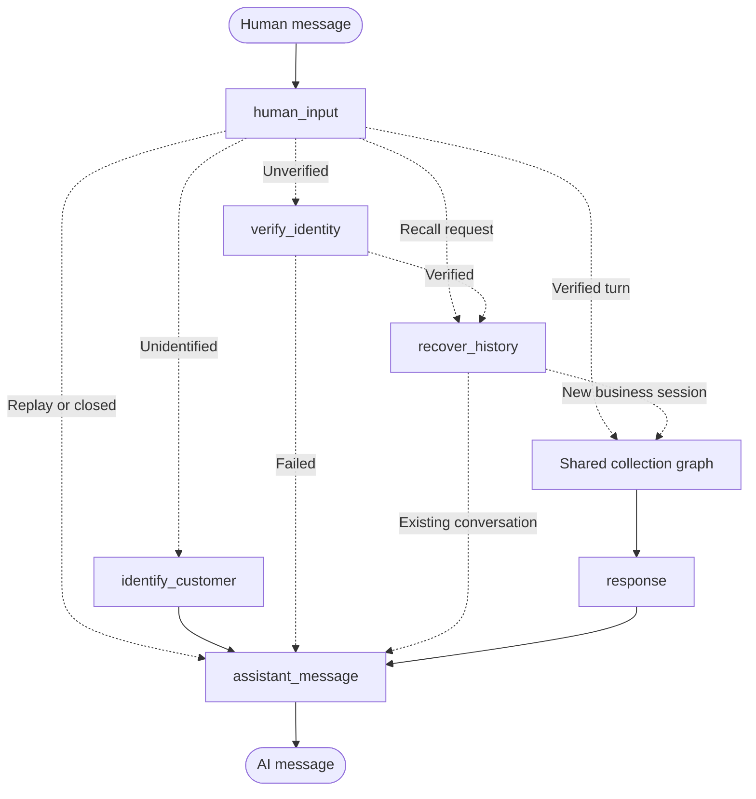
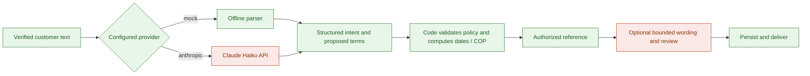
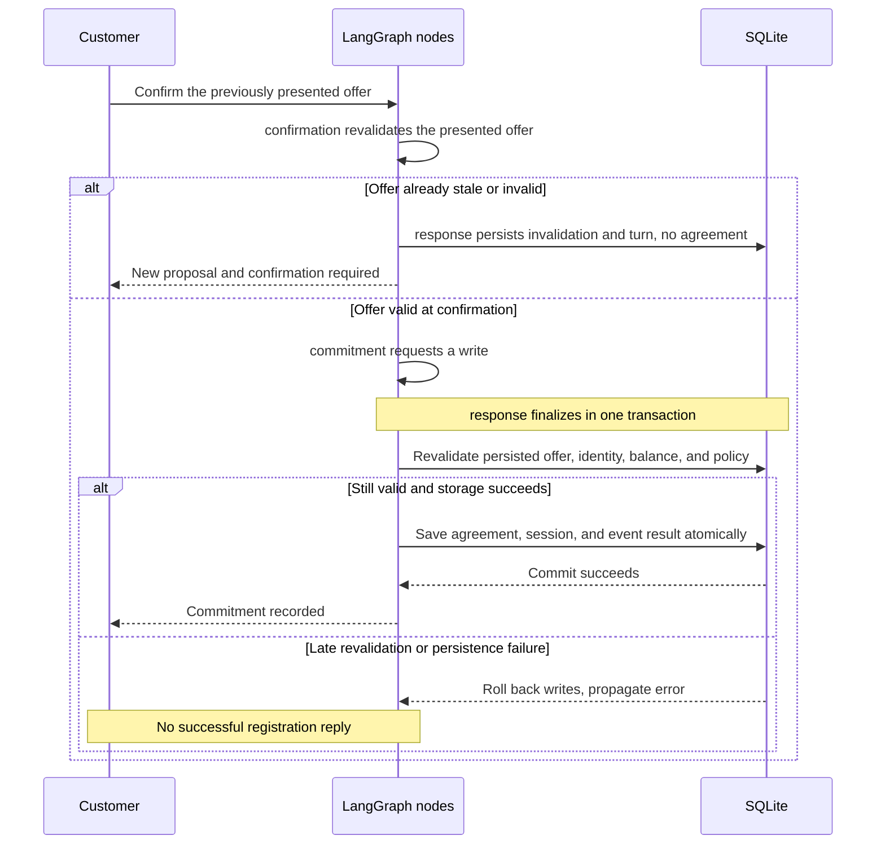
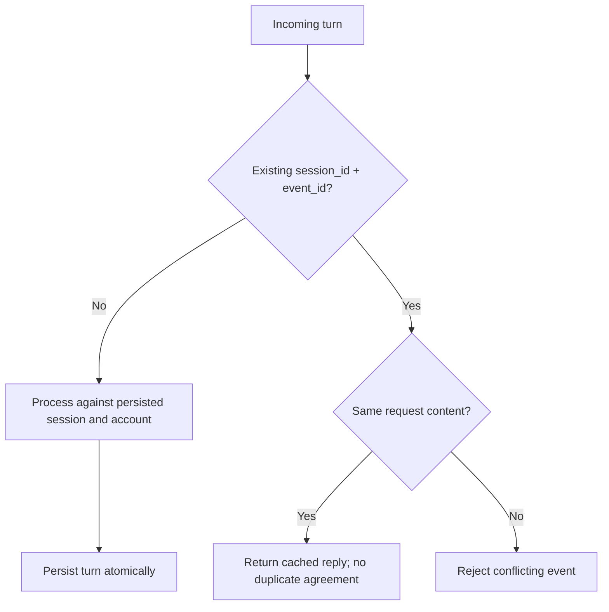
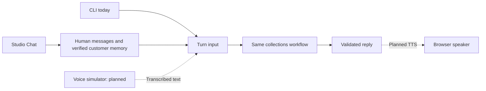

# Architecture

One LangGraph workflow processes **one turn per invocation**. Code routes the turn; an optional
LLM interprets context and rephrases non-financial questions. There is no multi-agent supervisor or parallel model fan-out.

## The shared collection graph

The CLI graph below is shared with the conversational Studio entry in [agent.py](../src/agents/collections/agent.py).
Solid arrows are fixed edges; dashed arrows are conditional routes.

Generate the current graph directly from code with `uv run collections-lab graph`.
The next customer message starts a new invocation using the same persisted session.
The internal wording retry is bounded to two drafts; it never retries negotiation or writes.
Model review is a quality filter, not a proof of semantic safety. The local simulation still
requires broader adversarial and conversational evaluation before a real pilot.

## Studio conversation entry

Studio supplies thread and message identifiers. Backend bindings select the customer and
business session after fictional identity verification. New threads verify again before
reading memory. Returning threads resume existing sessions; terminal sessions stay terminal.
Local summaries bound the displayed history without deleting source records or calling an LLM.

## Interpretation and policy

| Code owns | Demo rule |
| --- | --- |
| Initial contact | Authorized `phone_simulation` channel; Colombia calendar; contact history |
| Contact window | Mon–Fri 07:00–19:00; Sat 08:00–15:00; end excluded; Sundays/holidays blocked |
| Contact frequency | At most one established contact per day; no alternate channels in the same week |
| Identity | Fixture code before disclosing the balance; three failed attempts close the session |
| Payment terms | `demo-co-v1`: 1–3 monthly installments; first date today through today + 7 days |
| Money | Integer COP; preserve the total; adjust month-end dates; no discounts or added charges |
| Turn limits | Bounded clarifications/proposals; handoff after 20 persisted turns |

These are implemented demo controls, not a certification of legal compliance. The model cannot
authorize an exception, change the balance, or record a payment.

## Confirmation and persistence

`ConversationService` serializes the entire local turn in a transaction. Direct Studio execution
uses optimistic session revisions and a transaction at finalization. Staging needs concurrency
validation against its external storage adapter.

SQLite stores accounts, sessions, offers, agreements, events, contacts, Studio identity bindings,
and chat replay responses. Onboarding transitions and their responses commit atomically.
**Agreements are promises: the account balance stays unchanged.**

## Retries and trusted state

The CLI accepts `session_id`, `event_id`, `account_id`, and `text`. Studio accepts only `messages`;
its adapter derives event IDs and retrieves the session/account binding internally. The session is bound to
its account; identity, balance, and agreement IDs come from trusted storage. Session IDs alone
are not authentication. Closed, handed-off, and agreed sessions cannot reopen.

| Situation | Outcome |
| --- | --- |
| Unclear or rejected offer | Invalidate it; require newly presented terms before confirmation |
| Changed balance or policy | Invalidate old terms; require a new proposal and confirmation |
| Reported payment or dispute | Simulated handoff; no payment posting |
| Provider error | Neutral reply; no automatic provider/model switch |

## Channel boundaries

Voice, production authentication, external persistence, and AWS are future work. See the [roadmap](ROADMAP.md).
