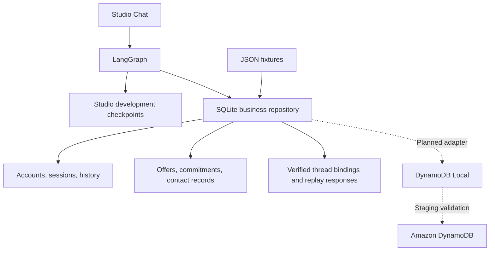
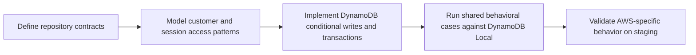

# Local persistence and DynamoDB development

## What runs today



| Data | Owner / location | Behavior |
| --- | --- | --- |
| Business records | `SQLiteRepository`, default `.local/collections.sqlite3` | Accounts, session history, offers, agreements, events, contacts |
| Studio identity and replay | `ChatMemory`, same SQLite file | Verified customer binding per thread; cached message results |
| Graph messages/checkpoints | LangGraph development runtime; local `.langgraph_api/` artifacts | Separate from business truth; not a production durable-checkpoint guarantee |
| Seed customers, accounts, codes | Versioned JSON under `src/agents/collections/data/fixtures/` | Synthetic inputs; existing accounts use insert-if-absent initialization |
| Customer summaries | Derived on demand from SQLite | Up to three verified sessions and three commitments; no LLM or destructive compaction |

`COLLECTIONS_DATABASE_PATH` selects the database. Relative paths resolve from the process
working directory, so each worktree normally has independent data. All paths above are
ignored by Git except the versioned fixtures. Sharing an absolute database path intentionally
shares business history and contact limits. Changing the path selects another database;
it does not migrate records.

The primary default is `~/Developer/AgenticDebtCollection/.local/collections.sqlite3`.
Business persistence survives process restarts while the file is retained. SQLite transactions,
unique event keys, and session revisions protect the current local workflow.

## Recommended next storage target

**Use DynamoDB Local in Docker when implementing the DynamoDB repository adapter.** It is
AWS's official local development option and does not require calling the cloud service.
Use a persistent volume plus `-dbPath` for retained demo data; `-inMemory` is for disposable
runs. Configure an explicit local SDK endpoint and dummy local credentials.
[AWS setup](https://docs.aws.amazon.com/amazondynamodb/latest/developerguide/DynamoDBLocal.html),
[AWS options and differences](https://docs.aws.amazon.com/amazondynamodb/latest/developerguide/DynamoDBLocal.UsageNotes.html).

| Option | Best fit for this project | Boundary |
| --- | --- | --- |
| SQLite today | Fast offline behavior and regression tests | Does not emulate DynamoDB semantics |
| DynamoDB Local | DynamoDB data model and repository integration | Does not reproduce managed throughput, availability, or recovery behavior |
| LocalStack | Later integration of several AWS services in one local environment | Check required service/API coverage and current limitations |

LocalStack also supports DynamoDB and documents its limitations:
[LocalStack DynamoDB](https://docs.localstack.cloud/aws/services/dynamodb/).
The preference for DynamoDB Local now is a project recommendation based on the narrower scope.

**No DynamoDB adapter, Docker service, or migration is implemented yet.** Changing the
SQLite path or starting an emulator alone cannot switch the agent to DynamoDB.



Refactor direct SQL in `ChatMemory` behind repository operations before adding an adapter.
Preserve atomic agreement/session/event writes, atomic identity/replay transitions, account
isolation, pending-offer recovery, and bounded history retrieval. Test pagination explicitly.
The business repository and graph checkpointer are separate migration decisions.

## Branches, worktrees, and local data

| After a squash merge | Current policy |
| --- | --- |
| Remote PR source branch | Deleted automatically |
| Local branch | Removed by local post-merge cleanup after eligibility checks |
| Local worktree directory | Removed when merged, clean, unlocked, and not in use |
| Ignored local database, `.env`, checkpoints | Backed up locally before removal; never merged into `main` |
| Rebuildable environments and caches | Removed with the worktree |
| Commit history | Squash commit on `main`; original commits remain inspectable through the PR |

Requires Python 3.9+, Git, authenticated GitHub CLI (`gh`), and `lsof` (macOS/Linux).
Run from the primary checkout after review and required CI:

```bash
python3 scripts/merge_pr.py 21  # Replace with the intended PR number
```

It squash-merges the PR, updates the clean primary checkout, then cleans eligible merged
branches/worktrees. A PR merged through GitHub needs this local command afterward (an already
merged PR is supported); GitHub's remote setting cannot delete local directories.

```bash
python3 scripts/cleanup_merged.py          # Audit only
python3 scripts/cleanup_merged.py --apply  # Clean old merged branches/worktrees
```

The cleanup preserves primary, active, dirty, locked, open-PR, and unmerged/divergent work.
Squash/rebased heads require matching complete trees and a merged PR present on main.
Closed-without-merge branches are retained unless independently reachable from main.
Backups under `.validation/worktree-cleanup/<timestamp>/` include a manifest, a Git bundle
of all removed local and remote branch tips, and verified archives of non-rebuildable ignored files.
Archives can contain local credentials: keep them private and out of version control.
`.venv`, build output, and caches are rebuildable and excluded. No backup is published.

For recovery, inspect `manifest.json`; `git bundle list-heads branches.bundle` lists saved
branch tips. Extract a data archive into a separate recovery directory before selecting files
to restore. Merging never moves a worktree's database into the primary checkout.

See [use cases](USE_CASES.md) for persistence, replay, concurrency, and migration acceptance cases.
