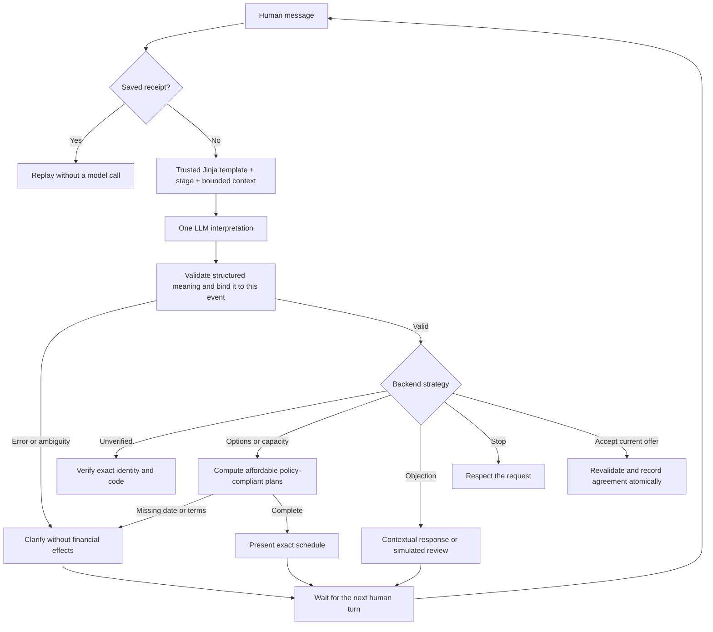
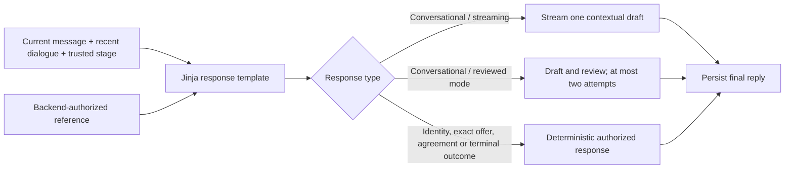

# Contextual negotiation

Every fresh human turn is interpreted by Haiku in model mode. Deterministic parsing is
an offline test fixture only. The backend owns identity, eligibility, amounts and persistence.

The conversational loop spans human turns. There is no autonomous loop repeatedly asking
for payment. Studio exposes `understand_message` before identity and business routing.

| Natural Spanish input | Backend behavior |
| --- | --- |
| `¿Qué opciones tengo?` | List eligible plans without creating an agreement |
| `Solo puedo destinar 250 mil al mes` → `mañana` | Carry capacity forward; present 3 × COP 200,000 with exact dates |
| `De acuerdo, acepto las condiciones que acabas de presentar` | Confirm only the current offer, after revalidation |
| `Acepto si me descuentan` | Treat as conditional; never sign the preceding offer |
| `Perdí mi trabajo` | Ask about affordable capacity without pressuring |
| `No puedo pagar nada` | Simulated review; no unaffordable automatic agreement |
| `Ayúdame a programar en Python` | Explain scope while keeping the conversation open |
| `Siento que no me escuchas` | Acknowledge the actual complaint and clarify |
| `No quiero continuar` | Close without agreement |

These are evaluation examples, not required commands. Interpretation can still be wrong;
expand evaluations with unfamiliar phrasing and keep financial decisions in backend code.

## Contextual responses

Default streaming mode does not wait for a complete-text review. Reviewed mode is optional
and costs additional model calls. The current message is bounded by the 4,000-character
input limit; recent context includes at most four redacted turns. Account history is only
available after verification. Redaction is not a guarantee of complete anonymization.

Only repository-owned templates are rendered. User messages are template data, never Jinja
source. Missing template variables fail explicitly. Internal model calls do not stream
classification JSON to the customer.

## State and negotiation limits

- SQLite persists thread identity, objections, capacity, terms, receipts and agreements.
- Monthly capacity is a ceiling; a one-off amount is not silently converted into monthly capacity.
- At most three monthly installments, first payment within seven days, no discounts or added charges.
- A changed proposal or unrelated conversational turn invalidates pending acceptance.
- At most three objection turns or three proposals precede simulated review.
- No payment is recorded merely because the customer promises or reports one.
- Paused onboarding does not keep requesting identity; ordinary chat does not consume code attempts.
- Ending collection does not block account questions or disputes in the same verified thread.
- After refusal or a customer-requested close, a newly understood request to continue or discuss
  payment options can resume negotiation. Old offers are invalidated; history and limits remain.
- Complaints, greetings and ambiguous assent never reopen collection. Disputes and reported
  payments go to simulated review without an agreement or a verified payment.
- Agreement and handoff outcomes cannot restart negotiation. Identity/contact failures remain
  blocked. The narrowly recognized historical false-closure recovery is also retained.

Use separate databases for independent scenarios. See [validation](VALIDATION.md) for tested
boundaries and [streaming](STREAMING.md) for latency and failure behavior.

## Live refactor evidence

The seven-turn Haiku graph test covered identity, options, COP 250,000 monthly capacity,
a relative date, natural acceptance and exactly one agreement of 3 × COP 200,000.
Each fresh turn made one semantic call; replay made none. Complaint/off-topic streaming
checks delivered first fragments in 1.5–1.9 seconds. These are graph/API measurements,
not a latency guarantee or a new manual browser validation.
