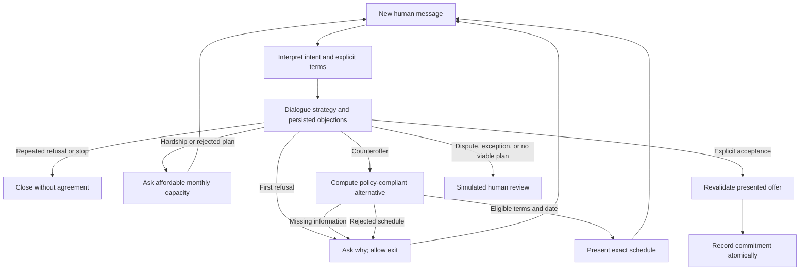

# Adaptive negotiation

Each human message starts one graph run. The conversation loops **between turns**, with
business state in SQLite. No autonomous loop pressures the customer while waiting for input.

These arrows include **customer turns**, not internal LangGraph back edges. Studio exposes
`interpret → dialogue_strategy → negotiation / confirmation / handoff / response` per turn.

| Try after verification | Expected outcome |
| --- | --- |
| `no quiero pagar nada` | Ask about the objection; no date-format demand |
| Repeat `no quiero pagar ¿qué vas a hacer?` | Respect refusal and close without threats |
| `perdí mi trabajo` → `250 mil` → `mañana` → `confirmo` | Ask capacity; propose 3 × COP 200,000; record only after confirmation |
| `solo puedo pagar 250 mil` → `cada mes` | Clarify frequency before inferring a monthly plan |
| `no puedo pagar` → `nada` | Simulated review without an unaffordable offer |
| `solo puedo pagar 100 mil al mes` | Policy exception needs simulated human review |
| Reject a presented plan, then request the same schedule | Remember the rejection and ask what must change |
| `acepto si me descuentan` | No acceptance; discount exception goes to simulated review |
| `no quiero pagar, no quiero continuar` | Stop immediately |

Use separate SQLite databases for independent scenarios. A finished conversation stays closed,
including when recalled in a new Studio thread. The mock parser supports these examples but
is not general language understanding. Haiku interprets broader language when explicitly enabled.

Rules remain: at most three monthly installments, first payment within seven days, no discounts,
no extra charges, explicit confirmation, unchanged debt balance until a payment is verified.
Monthly capacity is a ceiling, not an exact installment amount. A one-off amount is not silently
converted into a monthly promise. At most three objection turns or three presented proposals
precede simulated review. Rejected schedules (last three), dialogue stage, and history survive
process restarts. The LLM never writes agreements or changes the payment policy.
