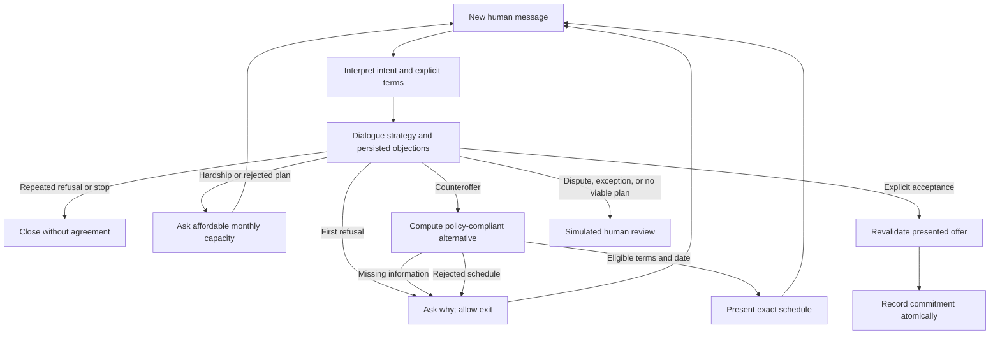
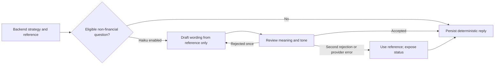
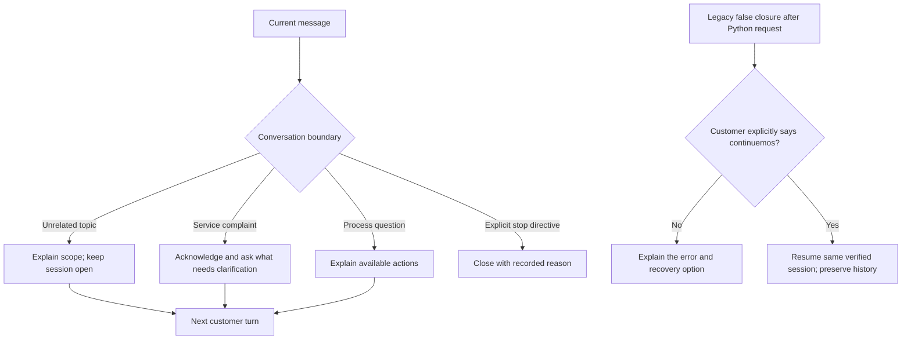
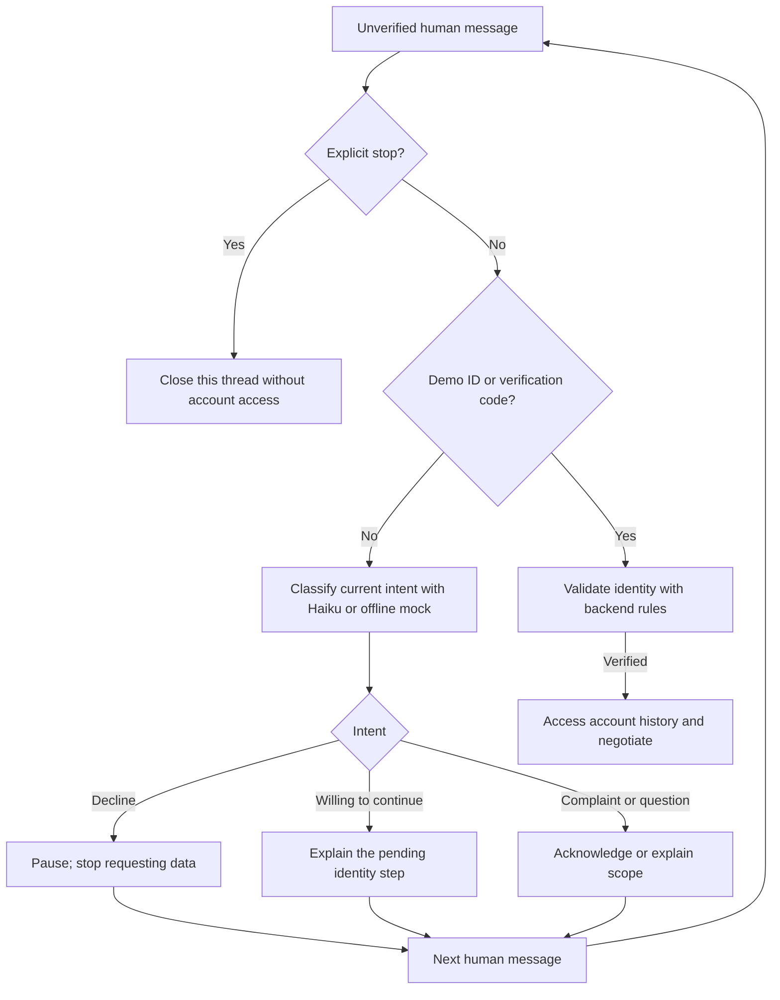

# Adaptive negotiation

Each human message starts one graph run. The conversation loops **between turns**, with
business state in SQLite. No autonomous loop pressures the customer while waiting for input.

These arrows include **customer turns**, not internal LangGraph back edges. Studio exposes
`interpret → dialogue_strategy → negotiation / confirmation / handoff / response` per turn.

| Try after verification | Expected outcome |
| --- | --- |
| `no quiero pagar nada` | Ask about the objection; no date-format demand |
| Repeat `no quiero pagar ¿qué vas a hacer?` | Respect refusal and close without threats |
| `perdí mi trabajo` → `250 mil` → `mañana` → `confirmo` | Ask capacity; propose 3 × COP 200,000; record only after confirmation |
| `solo puedo pagar 250 mil` → `cada mes` | Clarify frequency before inferring a monthly plan |
| `no puedo pagar` → `nada` | Simulated review without an unaffordable offer |
| `solo puedo pagar 100 mil al mes` | Policy exception needs simulated human review |
| Reject a presented plan, then request the same schedule | Remember the rejection and ask what must change |
| `acepto si me descuentan` | No acceptance; discount exception goes to simulated review |
| `no quiero pagar, no quiero continuar` | Stop immediately |

Use separate SQLite databases for independent scenarios. A finished conversation stays closed,
including when recalled in a new Studio thread. The mock parser supports these examples but
is not general language understanding. Haiku interprets broader language when explicitly enabled.

Rules remain: at most three monthly installments, first payment within seven days, no discounts,
no extra charges, explicit confirmation, unchanged debt balance until a payment is verified.
Monthly capacity is a ceiling, not an exact installment amount. A one-off amount is not silently
converted into a monthly promise. At most three objection turns or three presented proposals
precede simulated review. Rejected schedules (last three), dialogue stage, and history survive
process restarts. The LLM never writes agreements or changes the payment policy.

## Contextual wording and the internal loop

The interpreter uses the current message and up to four recent turns; current terms take
precedence over earlier objections. The writer and reviewer receive only the authorized
reference. This minimizes additional data exposure and prevents mismatched grounding.
No model rewrites an offer schedule, confirmed commitment, terminal outcome, or replay.
At most one interpretation call and four wording/review calls occur on an eligible turn;
exact confirmations and simple dates do not require interpretation calls. Wording errors
fall back visibly through `reply.wording_status`, without switching provider/model.

Offline evidence: `test_screenshot_refusals_are_understood_without_repeating_or_pressuring`,
`test_hardship_capacity_counteroffer_and_confirmation`,
`test_capacity_survives_installment_changes_and_rejection`, and
`test_studio_retry_loop_is_bounded_and_next_turn_resets`.

## Topic changes, complaints, and mistaken closure

`ayudame a programar en python`, `¿que paso?`, and `que mal servicio!!!` do not mean
stop, refusal to pay, or a debt dispute. Social turns do not consume clarification/refusal
attempts. Scope, complaint, and service-state replies use their authorized text directly so
wording cannot drop the scope limit or promise a real human connection. Any pending offer loses its acceptance status so a conversational `sí` cannot
accidentally sign it; terms and capacity remain available for a newly presented proposal.

A model's `end` classification cannot close the session without a supported explicit stop
directive in the current message. Hypothetical questions, quoted words, and programming phrases such as
`mi programa se cuelga` are not stop directives. An explicit stop still applies when
followed by a question, such as `No me llames más, ¿entendido?`. Broader language still needs evaluation.

Already closed sessions explain their outcome and acknowledge complaints. They stay closed,
except for the narrowly recognized legacy bug: a verified session closed by the old generic
closing message immediately after a recognized off-topic Python request, with no agreement,
no recorded legitimate close reason, and no later refusal/stop. Only `continuemos`, `retomemos`,
`quiero continuar`, or `quiero retomar` restores that same session. History and contacts remain;
no offer or agreement is accepted by recovery. Legitimate closures never reopen this way.

## Conversation before verification

Pause is stored per thread and survives restarts; only explicit stop closes onboarding.
Ordinary conversation never consumes verification attempts. Haiku classifies the current
message with numbers redacted; it receives no account history and cannot verify identity,
register a payment, or accept an agreement. Responses preserve the simulation boundary.
Provider failures are visible as `interpretation_status=model_error` and allow retry.
