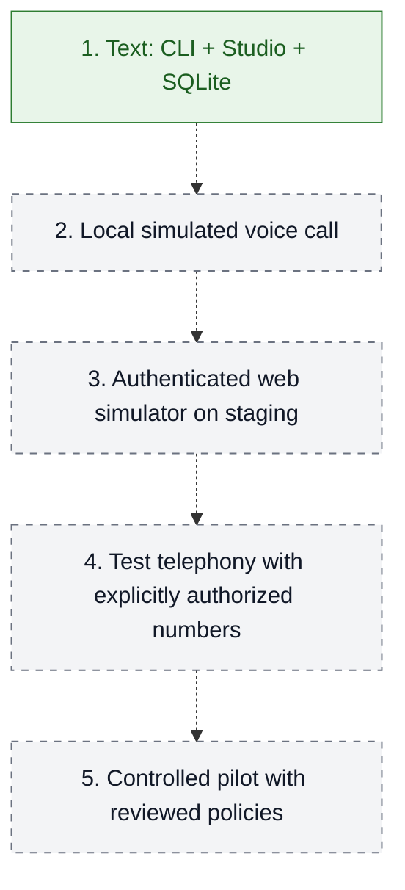
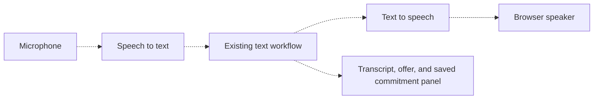

# Roadmap

Solid green = implemented locally. Dashed paths = future stages.

| Stage | Exit evidence |
| --- | --- |
| 1. Text | Offline workflow tests and local Studio API passed; live Haiku check still pending |
| 2. Simulated voice | Microphone → transcript → workflow → audible response, with no phone dialing |
| 3. Staging | Authentication, isolation, external persistence, concurrency, recovery, and observability tested |
| 4. Test telephony | Channel timing, interruptions, and handoff validated with authorized numbers |
| 5. Controlled pilot | Real integrations, policy review, supervision, and stop criteria approved |

## Next: a browser call without a phone number

**Planned, not implemented.** Start with manual turns; then evaluate streaming and interruptions.

The voice channel must track which offer was actually heard before accepting confirmation.
Generating audio alone does not establish that the customer heard the terms.

No Gradio app, voice provider, AWS resources, or real calls are included yet.
See [voice simulation](../apps/voice_simulator/README.md) and [deployment](../infra/README.md).
