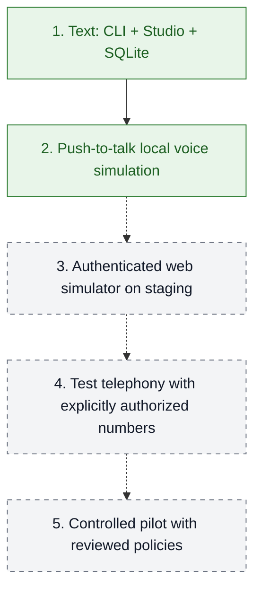
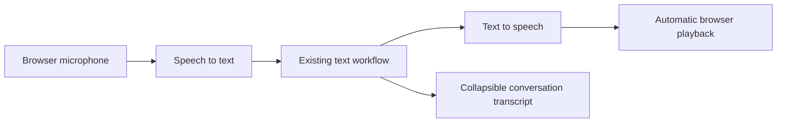

# Roadmap

Solid green = implemented locally. Dashed paths = future stages.

| Stage | Exit evidence |
| --- | --- |
| 1. Text | Offline workflow tests and local Studio API passed; live Haiku check still pending |
| 2. Simulated voice | Microphone → transcript → workflow → audible response, with no phone dialing |
| 3. Staging | Authentication, isolation, external persistence, concurrency, recovery, and observability tested |
| 4. Test telephony | Channel timing, interruptions, and handoff validated with authorized numbers |
| 5. Controlled pilot | Real integrations, policy review, supervision, and stop criteria approved |

## Local voice simulation

**Implemented locally:** a standalone HTML call interface over a local FastAPI API, with push-to-talk turns with automatic transcription, sending, and audio
playback. Browser playback completion enables the next reply. Continuous listening and
interruption-aware playback tracking remain planned.

The browser's audio-ended event is bound to the current response audio before enabling
another reply. Offer confirmation is also gated on the server; events for older audio
cannot unlock a new offer. An ended event does not prove audibility or uninterrupted
listening. Stronger interruption-aware playback tracking remains a later iteration.

### TODO: streaming voice

- [ ] Stream response audio only after the complete response text passes the existing
  business checks; preserve the exact approved amounts and dates.
- [ ] Validate the streaming endpoint with the configured voice and Free account,
  recording credits before and after the test, latency, and playback completion.
- [ ] Add realtime transcription, interruption handling, and reliable full-offer
  playback tracking in a later iteration. Keep push-to-talk turns as the current baseline.

No AWS resources or real telephone calls are included.
See [voice simulation](../apps/voice_simulator/README.md) and [deployment](../infra/README.md).
