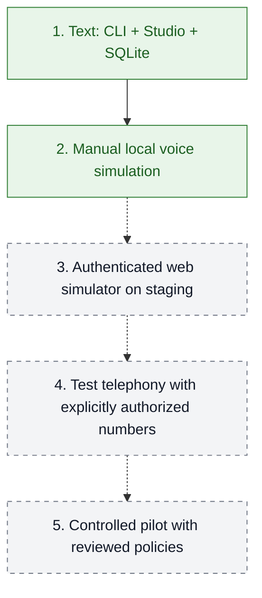
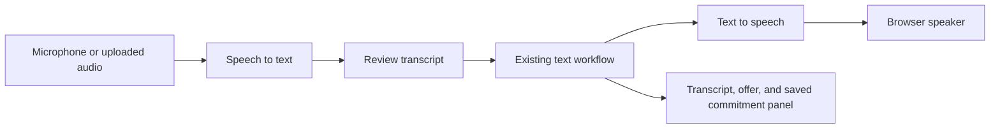

# Roadmap

Solid green = implemented locally. Dashed paths = future stages.

| Stage | Exit evidence |
| --- | --- |
| 1. Text | Offline workflow tests and local Studio API passed; live Haiku check still pending |
| 2. Simulated voice | Microphone → transcript → workflow → audible response, with no phone dialing |
| 3. Staging | Authentication, isolation, external persistence, concurrency, recovery, and observability tested |
| 4. Test telephony | Channel timing, interruptions, and handoff validated with authorized numbers |
| 5. Controlled pilot | Real integrations, policy review, supervision, and stop criteria approved |

## Local voice simulation

**Implemented locally:** manual Gradio turns with ElevenLabs transcription and speech.
Continuous listening, automatic playback tracking, and interruption handling remain planned.

The first version requires manual acknowledgement of the current complete offer after
audio is generated, before sending the next turn. An acknowledgement is recorded against
the response and audio; it is not automatic proof of playback or audibility.
Automatic interruption-aware playback tracking remains a later iteration.

### TODO: streaming voice

- [ ] Stream response audio only after the complete response text passes the existing
  business checks; preserve the exact approved amounts and dates.
- [ ] Validate the streaming endpoint with the configured voice and Free account,
  recording credits before and after the test, latency, and playback completion.
- [ ] Add realtime transcription, interruption handling, and reliable full-offer
  playback tracking in a later iteration. Keep manual turns as the current baseline.

No AWS resources or real telephone calls are included.
See [voice simulation](../apps/voice_simulator/README.md) and [deployment](../infra/README.md).
