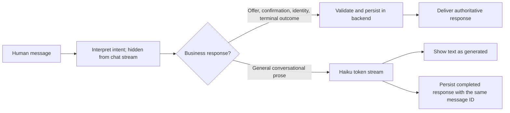

# Conversational streaming

`COLLECTIONS_RESPONSE_MODE=streaming` is the local-server default. `reviewed` restores
whole-text review and its bounded retry loop. The offline mock remains deterministic.

- Streaming prose has **no whole-text reviewer before display**. Prompts constrain scope;
  backend checks still control identity, eligible offers and agreement writes. Generated
  words do not authorize business actions, but wording is not guaranteed by those checks.
- First greetings and exact identity instructions need no generative wording call.
- Intent extraction and reviewed-mode drafts detach graph streaming callbacks and carry
  `langsmith:nostream`; only customer prose is streamed. Agent Server 0.15.4 does not suppress
  raw internal events using that tag alone. Internal calls therefore do not inherit the graph's
  streaming callback or its nested tracing callback; this is a tracing tradeoff, not a claim
  that tracing is globally disabled.
- LangGraph/Studio consumes the native `messages` stream. Preserve the streamed message ID
  when applying the final state; otherwise clients may render duplicate assistant bubbles.
- Interrupted prose is marked `wording_status=interrupted`; no automatic regeneration after
  partial output. Final state includes an interruption notice. Replay returns that saved result.
- `first_token_ms` and `generation_ms` measure the generation call only, excluding intent
  extraction, network/browser rendering and queueing. Deterministic replies have no token timing.

No fake typing delay or extra model call copies an already completed response. Financial
responses are delivered after persistence, rather than streamed before validation.

[LangGraph streaming documentation](https://docs.langchain.com/oss/python/langgraph/streaming).
