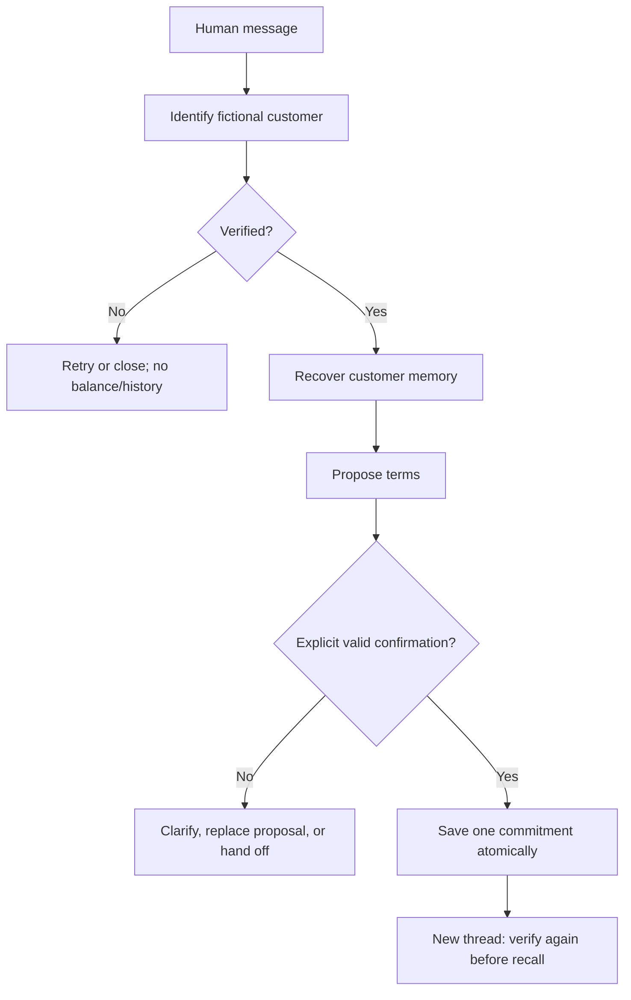
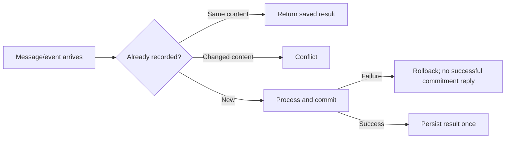

# Use-case catalog

Current simulation scenarios, expected outcomes, and evidence. All customers, IDs, debts,
and verification codes are fictional. A saved commitment is **not a payment**.

**A** = automated regression; **B** = also exercised in Studio Chat; **P** = pending.
An automated parser or policy test proves that layer, not a browser or live-provider test.
The test names below are runnable with `uv run pytest -q -k <test_name>`.

## Run a scenario

| Setup | Value |
| --- | --- |
| Customer A | ID `1000000001`; code `verificar 1111`; COP 600,000 |
| Customer B | ID `1000000002`; code `verificar 2222`; COP 450,000 |
| Clock | `COLLECTIONS_DEMO_NOW=2026-10-19T09:00:00-05:00` |
| Provider | `COLLECTIONS_LLM_PROVIDER=mock`; no paid calls |
| Independent case | Set `COLLECTIONS_DATABASE_PATH` in `.env` to a new file such as `.local/use-cases/hp-01.sqlite3`, then restart the server |
| Recall/retry case | Keep the same database; open another thread only when instructed |

Run `uv run langgraph dev`, select `collections_agent`, and use **Chat**.
A new Studio thread does not erase business records or contact history. Preserve existing
databases; choose another filename for an independent test. Dates below use the fixed clock.



## Happy paths

For HP-01 through HP-05, begin with `Hola` → `Mi cédula es 1000000001` → `verificar 1111`.
Use a fresh database for each independent case.

| ID | Human input / action | Expected outcome | Evidence |
| --- | --- | --- | --- |
| HP-01 | `pago completo el 2026-10-20` → `confirmo` | Present COP 600,000 on one date; save one unpaid commitment | A: `test_complete_payment_uses_one_installment` |
| HP-02 | `quiero 3 cuotas desde 2026-10-20` → `confirmo` | COP 200,000 on Oct 20, Nov 20, Dec 20; exactly one agreement | A+B: `test_messages_only_end_to_end_and_replay` |
| HP-03 | `quiero 3 cuotas` → `2026-10-20` → `confirmo` | Ask for missing terms; offer appears only when complete | A: `test_missing_date_can_be_supplied_on_following_turn` |
| HP-04 | Propose three installments, then `quiero 2 cuotas desde 2026-10-21` → `confirmo` | Replace old terms; accept only the new two-installment offer | A: `test_new_proposal_replaces_previous_offer` |
| HP-05 | Propose installments, then `pago completo el 2026-10-21` | Replace installments with one full-payment amount | A: `test_switching_from_installments_to_full_payment_resets_installment_count` |
| HP-06 | After HP-02, open a new thread; provide the same ID and code | Show the saved agreement and dates only after fresh verification | A+B: `test_new_thread_requires_verification_then_recalls_agreement` |
| HP-07 | Before confirming, open another thread and verify the same customer | Restate pending dates/amounts; allow confirmation without another outbound contact | A: `test_new_thread_resumes_pending_offer_without_new_contact` |
| HP-08 | Restart repository/service with the same database and confirm pending terms | Recover the offer and persist one commitment | A: `test_resume_with_new_repository_and_service_preserves_pending_offer` |
| HP-09 | Start customer B in a separate thread | Use B's balance; never show A's history or agreement | A: `test_other_customer_never_receives_first_customer_history` |

## Identity, input, and memory

Coverage: [Studio chat tests](../tests/test_studio_chat.py),
[Studio schema tests](../tests/test_studio_schema.py), and [workflow tests](../tests/test_workflow.py).

| ID | Trigger | Expected outcome | Evidence |
| --- | --- | --- | --- |
| ID-01 | Ask about debt before verification | No balance, proposal, or customer history disclosed | A: `test_identity_blocks_balance_and_offer_creation` |
| ID-02 | ID alone or incorrect code in a returning thread | No prior agreement disclosed | A: `test_new_thread_requires_verification_then_recalls_agreement` |
| ID-03 | Three incorrect codes | Close that thread; a later correct code cannot reopen it | A: `test_three_wrong_codes_close_only_that_thread` |
| ID-04 | Replay the identical failed verification event | Do not consume another attempt | A: `test_replayed_wrong_code_does_not_consume_attempts` |
| ID-05 | `terminar` before ID or code verification | Close without reading history or recording contact | A: `test_stop_during_onboarding_never_reads_history` |
| ID-06 | Inject account/session/verified fields alongside public messages | Ignore non-input state; backend identity remains authoritative | A: `test_public_fields_cannot_inject_backend_identity` |
| ID-07 | Supply provider, repository, or structured values through runtime context | Reject untrusted dependencies; allow only transport metadata | A: `test_studio_context_rejects_client_dependencies` |
| ID-08 | Studio sends text content blocks | Accept as human text; return an AI message | A+B: `test_studio_text_content_blocks_are_supported` |
| ID-09 | Send an image attachment | Reject before identity or agreement writes | A: `test_attachments_are_rejected_without_identity_side_effects` |
| ID-10 | Twenty prior conversations with long turns | Return a bounded factual summary of three sessions; preserve all originals | A: `test_summary_is_bounded_and_preserves_source_records` |
| ID-11 | Lose graph checkpoints but retain the database and verified thread binding | Recover customer memory from backend storage | A: `test_backend_recovers_even_without_checkpoint_history` |
| ID-12 | Change an existing business session's account | Reject account switching | A: `test_session_cannot_change_account` |

## Negotiation and human-review paths

Coverage: [workflow tests](../tests/test_workflow.py) and [interpretation tests](../tests/test_interpreter.py).
Human review is a simulated terminal state; no employee is contacted.

| ID | Trigger | Expected outcome | Evidence |
| --- | --- | --- | --- |
| NG-01 | `confirmo` before an offer | No agreement | A: `test_accepting_without_offer_does_not_create_agreement` |
| NG-02 | `no acepto` or `confirmo si me descuentan cien mil` | No agreement; invalidate pending acceptance context | A: `test_rejection_or_conditional_acceptance_never_creates_agreement` |
| NG-03 | Conditional acceptance followed by a bare `sí` | Require a newly presented proposal | A: `test_conditional_acceptance_invalidates_offer_before_following_yes` |
| NG-04 | Question phrased like acceptance | Never interpret the question as confirmation | A: `test_question_is_not_confirmation`, `test_anthropic_question_cannot_confirm` (provider stub) |
| NG-05 | `quiero 12 cuotas desde 2026-10-20` | Simulated handoff; no automatic agreement | A: `test_unsupported_installment_count_requires_human_review` |
| NG-06 | `ya pagué` | Human review; balance unchanged; no payment posting | A: `test_reported_payment_does_not_mark_debt_as_paid` |
| NG-07 | `no reconozco esa deuda` | Stop negotiation; later acceptance cannot create an agreement | A: `test_dispute_stops_negotiation` |
| NG-08 | `terminar` after a proposal, then `confirmo` | Session remains closed; no agreement | A: `test_explicit_close_prevents_later_acceptance` |
| NG-09 | Replace a valid offer with a date outside policy | Old offer cannot be accepted afterward | A: `test_invalid_new_proposal_cannot_accept_previous_offer` |
| NG-10 | Model output invents identity or changes financial fields on acceptance | Reject authoritative fields or prevent acceptance promotion | A: `test_model_cannot_invent_identity_code`, `test_acceptance_cannot_smuggle_changed_financial_fields` (provider stubs) |
| NG-11 | Negated date / incomplete amount wording | Conservative interpretation; no invented date or authorization | A: `test_negated_date_is_not_extracted_as_a_draft_update`, `test_mixed_numeric_word_amount` |

## Money, dates, and contact boundaries

These are **implemented demo rules**, not a legal-compliance certification.
Policy evidence: [test_policy.py](../tests/test_policy.py).
Contact evidence: [test_contact.py](../tests/test_contact.py).

| ID | Boundary | Expected outcome | Evidence |
| --- | --- | --- | --- |
| ED-01 | Uneven installment division | Preserve every COP; all installments positive | A: `test_rounding_preserves_every_peso`, `test_all_installments_must_be_positive` |
| ED-02 | Month end, leap year, or December rollover | Valid monthly dates based on the original day | A: `test_month_end_uses_original_day`, `test_calendar_crosses_year` |
| ED-03 | First payment on day 7, before today, or after day 7 | Allow inclusive last day; reject dates outside the window | A: `test_last_day_in_window_allowed`, `test_outside_first_payment_window_rejected` |
| ED-04 | Invalid installment count or fractional COP | Reject unsupported terms | A: `test_invalid_installment_counts_rejected`, `test_fractional_cop_and_unsupported_policy_rejected` |
| ED-05 | Same terms twice | Stable offer identifier | A: `test_equal_terms_have_stable_id` |
| ED-06 | Tampered offer or creation date in the future | Reject before commitment | A: `test_tampered_offer_rejected`, `test_future_creation_rejected` |
| ED-07 | Balance, account version, or policy changes after proposal | Invalidate old terms; require new proposal/confirmation | A: `test_changed_account_invalidates_offer`, `test_changed_policy_invalidates_offer`, `test_balance_change_invalidates_pending_offer` |
| CT-01 | Weekday 07:00 / 19:00; Saturday 08:00 / 15:00 | Start inclusive, end exclusive; convert to Bogotá time | A: `test_hours_and_timezone` |
| CT-02 | Sunday or Colombia holiday | Block new contact | A: `test_hours_and_timezone`, `test_fixed_movable_and_monday_observed_holidays` |
| CT-03 | Missing authorization or timezone | Block contact | A: `test_no_authorization_or_naive_clock_rejected`, `test_unauthorized_contact_blocks_start_without_balance_or_contact_record` |
| CT-04 | Another established contact on the same day | Block a new business contact; unestablished attempts do not count | A: `test_same_day_direct_contact_prevents_retry`, `test_same_account_cannot_be_contacted_again_same_day` |
| CT-05 | Another channel used in the same week / next week | Block same-week alternate channel; allow next week if other rules pass | A: `test_other_channel_same_week_prevents_contact`, `test_new_week_allows_other_channel` |
| CT-06 | Incomplete, malformed, or future contact history | Fail closed | A: `test_invalid_history_fails_closed` |

## Failures, retries, and consistency



| ID | Injected failure / retry | Expected outcome | Evidence |
| --- | --- | --- | --- |
| ER-01 | Replay confirmation with the same event ID and content | Same response, no duplicate agreement or AI message | A: `test_messages_only_end_to_end_and_replay`, `test_exact_event_replay_is_idempotent_and_conflicting_event_is_rejected` |
| ER-02 | Reuse an event ID with changed text | Conflict; no overwrite | A: same replay tests |
| ER-03 | Concurrent confirmations through separate repository instances | Exactly one agreement | A: `test_concurrent_retries_across_repository_instances_create_one_agreement` |
| ER-04 | Fail final persistence after agreement creation | Roll back agreement, session, and event together | A: `test_recording_failure_rolls_back_agreement_session_and_event`, `test_raw_studio_invocation_does_not_keep_agreement_when_save_turn_fails` |
| ER-05 | Fail the first business turn | No orphan session or contact record | A: `test_failed_first_turn_does_not_leave_contact_or_session` |
| ER-06 | Fail assistant delivery after identity transition commits | Retry returns cached result; attempt count unchanged | A: `test_failed_assistant_node_does_not_repeat_identity_transition` |
| ER-07 | Interrupt history recovery after successful verification | Retry completes recovery without requiring new verification | A: `test_verification_recovers_after_interrupted_history_node` |
| ER-08 | Provider exception, invalid schema, or unsupported provider | No silent provider fallback; validate output; graph error handling is separate | A: `test_provider_errors_are_not_hidden`, `test_provider_output_is_schema_validated`, `test_unknown_provider_is_not_silently_mocked` |

## Known limitations and pending acceptance cases

| ID | Status | Scenario / acceptance target |
| --- | --- | --- |
| GAP-01 | Implemented limit | Mock understands a bounded Spanish grammar; it is not unrestricted natural-language negotiation. Live Haiku accuracy, cost, and end-to-end outage handling need validation. |
| GAP-02 | Implemented limit | Each thread has one customer binding. Changing customer requires a new thread and verification. Terminal business sessions stay terminal when recalled. |
| GAP-03 | Implemented limit | Only verified business sessions enter customer summaries. A prior unverified CLI contact still counts toward contact limits. Use another database for independent demos. |
| GAP-04 | P | Dedicated workflow tests for every clarification/turn/identity edge: unknown ID, empty/oversized message, non-human input, advisor request, and maximum turn count. Some guards exist in code; a dedicated regression is not claimed here. |
| GAP-05 | P | Production authentication, identity expiry/revocation, cross-user permissions, retention, and redaction policies. Demo verification is not production authentication. |
| GAP-06 | P | DynamoDB adapter: conditional writes, transaction rollback, duplicate events, contention, pagination, and schema migration parity with SQLite. |
| GAP-07 | P | AWS staging: IAM isolation, service throttling, retries, latency, backups, and recovery. Local emulation alone does not validate these. |
| GAP-08 | P | Voice simulation: transcription errors, silence, interruption during terms, cancellation of speech, and confirmation only after the full offer was heard. |
| GAP-09 | P | Real telephony, authorized numbers, disconnect/reconnect, human transfer, and reviewed production contact policies. |
| GAP-10 | P | Multiple debts per customer, settlement discounts, real payment reconciliation, and durable handoff queues. |

## CI and maintenance

The required CI starts a real server and checks text-block messages, confirmation replay,
new-thread verification/recall, and isolation between two customers:
[check_langgraph_startup.py](../scripts/check_langgraph_startup.py).

```bash
uv run pytest -q
uv run --no-sync python scripts/check_langgraph_startup.py
```

The short machine-readable seed list remains [eval/scenarios.json](../eval/scenarios.json).
It is a scenario list, not an automated evaluation runner. This document is the detailed
acceptance and evidence catalog; [VALIDATION.md](VALIDATION.md) summarizes execution boundaries.

For each new feature, add a stable case ID, setup, trigger, expected state, persistence
invariant, evidence/test name, and status. Turn a reported issue into a failing regression
before marking it resolved. Keep future cases marked **P** until evidence exists.
