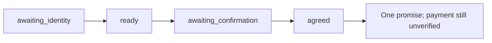

# Validation

## Reproduce a full-payment commitment

Use a fresh database and the default demo clock (October 19, 2026). All four commands run offline.

```bash
uv run collections-lab turn --provider mock --database .local/full-payment.sqlite3 --session full-payment --event-id 1 --text ''
uv run collections-lab turn --provider mock --database .local/full-payment.sqlite3 --session full-payment --event-id 2 --text 'verificar 1111'
uv run collections-lab turn --provider mock --database .local/full-payment.sqlite3 --session full-payment --event-id 3 --text 'pago 600000 mañana'
uv run collections-lab turn --provider mock --database .local/full-payment.sqlite3 --session full-payment --event-id 4 --text 'confirmo'
uv run collections-lab agreements --database .local/full-payment.sqlite3
```



Repeat event `4` unchanged: expect the cached reply and still one agreement.
Change its text while keeping the same event ID: expect a conflict.

## Verification boundary

| Verified locally | Evidence |
| --- | --- |
| Policies and interpretation | Offline unit tests for amounts, dates, contact controls, and conservative parsing |
| Stateful workflow | Recovery, retries, isolation, concurrent persistence, invalidated offers, and rollback tests |
| Studio schema | Messages-only input, AI responses, verified identity, cross-thread recall, and customer isolation tests |
| Studio development server API | CI starts the real server, checks health/registration/schema, runs human-message conversations with thread/checkpoint metadata, verifies replay, returning-customer recall, and isolation between two customers |
| Studio browser Chat | Chrome: natural messages through identity, negotiation, and confirmation; a new thread recovered the same agreement after verification; Graph mode exposed all identity and memory nodes |
| Live Haiku dialogue (2026-10-18) | Two synthetic Studio-graph conversations: repeated refusal closes without agreement; hardship → COP 250,000 monthly capacity → tomorrow → confirmation saves 3 × COP 200,000. Both objection questions received validated generated wording. These were graph/API calls, not a new manual browser pass. |
| Packaging | Lint, formatting, locked dependencies, wheel, and source distribution |

| Pending | Requires |
| --- | --- |
| Broader live Haiku evaluation | More varied utterances, adversarial inputs, latency/cost measurement, and real outage tests |
| Physical microphone and automatic interruption handling | Manual microphone acceptance and a later continuous-audio implementation |
| AWS and real telephony | Later-stage deployment and channel validation |

No model, speech, telephony, or business API calls were used for the offline validation.
The scenario catalog is in [eval/scenarios.json](../eval/scenarios.json); audio interruption is a future case.

## Voice checks

`uv sync --locked --extra voice` installs the optional simulator dependencies.
`uv run --extra voice pytest -q tests/test_voice.py` uses fake audio and a mock HTTP
transport: no paid calls. It covers request shape, redacted failures, transcript review,
current-offer acknowledgement, TTS retries without duplicate agreements, session isolation,
and Gradio construction. Existing workflow tests remain applicable.

Live TTS was verified with the configured designed voice (HTTP 200, MP3) before PR #28.
Live Scribe v2 transcribed a generated customer clip as `Quiero tres cuotas desde mañana`.
In Chrome, typed identity turns followed by that transcript produced three COP 200,000
installments. Confirmation without acknowledgement was rejected; after full playback and
manual acknowledgement, exactly one unpaid commitment was found in SQLite. Transcribing
the offer audio preserved its amounts and dates.

Browser file upload automation was blocked by the Chrome extension's local-file permission;
physical microphone capture was unavailable in that browser session. Those two UI input
paths still need manual acceptance. STT was validated directly through the same adapter.
No automatic interruption or audibility claim is made. Keep live evidence under ignored
`.validation/`.

## Run the checks

```bash
uv run pytest -q
uv run ruff check src tests scripts
uv run ruff format --check src tests scripts
uv run --no-sync python scripts/check_langgraph_startup.py
uv lock --check
uv build
```

See the [test map](../tests/README.md) for coverage by module.
