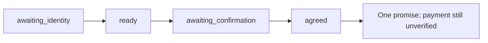

# Validation

## Reproduce a full-payment commitment

Use a fresh database and the default demo clock (October 19, 2026). All four commands run offline.

```bash
uv run collections-lab turn --provider mock --database .local/full-payment.sqlite3 --session full-payment --event-id 1 --text ''
uv run collections-lab turn --provider mock --database .local/full-payment.sqlite3 --session full-payment --event-id 2 --text 'verificar 1111'
uv run collections-lab turn --provider mock --database .local/full-payment.sqlite3 --session full-payment --event-id 3 --text 'pago 600000 mañana'
uv run collections-lab turn --provider mock --database .local/full-payment.sqlite3 --session full-payment --event-id 4 --text 'confirmo'
uv run collections-lab agreements --database .local/full-payment.sqlite3
```



Repeat event `4` unchanged: expect the cached reply and still one agreement.
Change its text while keeping the same event ID: expect a conflict.

## Verification boundary

| Verified locally | Evidence |
| --- | --- |
| Policies and interpretation | Structured semantic contracts, event-bound meaning, fail-closed consumers, financial rules, and explicitly offline mock fixtures |
| Stateful workflow | Recovery, retries, isolation, concurrent persistence, invalidated offers, and rollback tests |
| Studio schema | Messages-only input, AI responses, verified identity, cross-thread recall, and customer isolation tests |
| Studio development server API | CI starts the real server, checks health/registration/schema, runs human-message conversations with thread/checkpoint metadata, verifies replay, returning-customer recall, and isolation between two customers |
| Studio browser Chat | Chrome: natural messages through identity, negotiation, and confirmation; a new thread recovered the same agreement after verification; Graph mode exposed all identity and memory nodes |
| Live Haiku refactor (2026-10-18) | Seven-turn graph flow: natural ID/code → options → COP 250,000 monthly capacity → tomorrow → natural acceptance → exactly one agreement of 3 × COP 200,000. One semantic call per fresh turn; replay adds zero calls. Complaint and off-topic streaming tests kept the conversation open, with first fragments in 1.5–1.9 seconds. This is graph/API evidence, not a new manual Studio browser pass or a latency guarantee. |
| Packaging | Lint, formatting, locked dependencies, wheel, and source distribution |

| Pending | Requires |
| --- | --- |
| Broader live Haiku evaluation | More varied utterances, adversarial inputs, latency/cost measurement, and real outage tests |
| Voice and interruption handling | Stage 2 implementation and playback checks |
| AWS and real telephony | Later-stage deployment and channel validation |

No model, speech, telephony, or business API calls were used for the offline validation.
The scenario catalog is in [eval/scenarios.json](../eval/scenarios.json); audio interruption is a future case.

## Run the checks

```bash
uv run pytest -q
uv run ruff check src tests scripts
uv run ruff format --check src tests scripts
uv run --no-sync python scripts/check_langgraph_startup.py
uv lock --check
uv build
```

See the [test map](../tests/README.md) for coverage by module.
