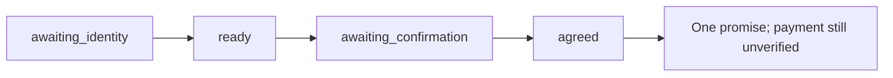

# Validation

## Reproduce a full-payment commitment

Use a fresh database and the default demo clock (October 19, 2026). All four commands run offline.

```bash
uv run collections-lab turn --provider mock --database .local/full-payment.sqlite3 --session full-payment --event-id 1 --text ''
uv run collections-lab turn --provider mock --database .local/full-payment.sqlite3 --session full-payment --event-id 2 --text 'verificar 1111'
uv run collections-lab turn --provider mock --database .local/full-payment.sqlite3 --session full-payment --event-id 3 --text 'pago 600000 mañana'
uv run collections-lab turn --provider mock --database .local/full-payment.sqlite3 --session full-payment --event-id 4 --text 'confirmo'
uv run collections-lab agreements --database .local/full-payment.sqlite3
```



Repeat event `4` unchanged: expect the cached reply and still one agreement.
Change its text while keeping the same event ID: expect a conflict.

## Verification boundary

| Verified locally | Evidence |
| --- | --- |
| Policies and interpretation | Offline unit tests for amounts, dates, contact controls, and conservative parsing |
| Stateful workflow | Recovery, retries, isolation, concurrent persistence, invalidated offers, and rollback tests |
| Studio schema | Import and public JSON input schema tests; no repository object exposed as input |
| Studio development server API | Health, graph registration, schemas, and four HTTP turns reaching `agreed` |
| Packaging | Lint, formatting, locked dependencies, wheel, and source distribution |

| Pending | Requires |
| --- | --- |
| Studio browser UI | Browser-based interaction test; API validation does not cover the UI |
| Live Haiku extraction | Credentials and an explicit token budget |
| Voice and interruption handling | Stage 2 implementation and playback checks |
| AWS and real telephony | Later-stage deployment and channel validation |

No model, speech, telephony, or business API calls were used for the offline validation.
The scenario catalog is in [eval/scenarios.json](../eval/scenarios.json); audio interruption is a future case.

## Run the checks

```bash
uv run pytest -q
uv run ruff check src tests
uv run ruff format --check src tests
uv lock --check
uv build
```

See the [test map](../tests/README.md) for coverage by module.
