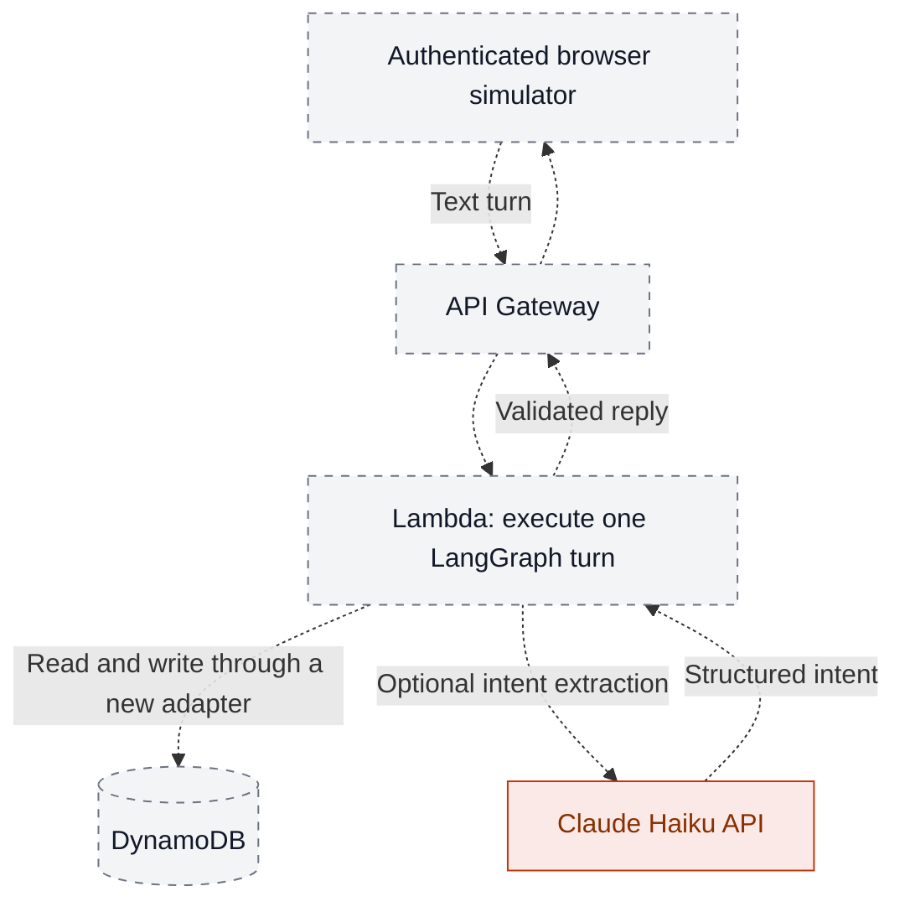

# AWS staging design

**Stage 3: planned.** This directory contains no provisioned AWS resources or infrastructure code.

Dashed paths describe a proposed deployment. Lambda will process one turn; Studio remains a
development tool. The full development Agent Server will not be packaged inside Lambda.

| Before staging | Required work |
| --- | --- |
| Storage | Implement a DynamoDB adapter; test atomic confirmation, retries, and session concurrency |
| Access | Authentication, authorization, and customer/session isolation |
| Operations | Secrets, observability, recovery, and an explicit budget |
| Voice | Validate the local simulator first; speech adapters remain outside the financial workflow |

Current persistence is SQLite. [Roadmap](../docs/ROADMAP.md) · [Architecture](../docs/ARCHITECTURE.md)
