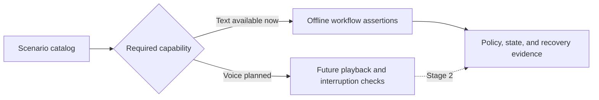

# Agent evaluation

Reserved for future evaluation utilities. Current checks live in [tests](../../../tests/README.md);
[eval/scenarios.json](../../../eval/scenarios.json) is a scenario catalog, not an evaluation runner.

Evaluate exact amounts, policy adherence, recovery, and conversational clarity.
A recorded commitment must remain distinct from a verified payment.
