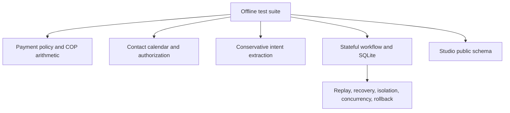

# Offline tests

```bash
uv run pytest -q
```

Coverage map, not runtime parallelism:



| Module | Coverage |
| --- | --- |
| [test_policy.py](test_policy.py) | Terms, dates, and exact amounts |
| [test_contact.py](test_contact.py) | Time windows, holidays, and contact rules |
| [test_interpreter.py](test_interpreter.py) | Limited offline parsing and structured extraction contracts |
| [test_workflow.py](test_workflow.py) | Conversation paths, storage, retries, and failure handling |
| [test_studio_chat.py](test_studio_chat.py) | Human messages, backend identity, verified recall, bounded summaries, replay, and customer isolation |
| [test_studio_schema.py](test_studio_schema.py) | Public JSON inputs, Studio thread metadata, and rejection of untrusted context |

Workflow tests block network access. Live Anthropic calls and browser voice behavior are not covered.
See [validation](../docs/VALIDATION.md) for runnable examples and remaining checks.

CI also runs [check_langgraph_startup.py](../scripts/check_langgraph_startup.py), adapted from
AdvancedGenAI: a temporary Agent Server processes human-message HTTP conversations, replays, and verified cross-thread recall with
Studio-style thread context. It uses mock interpretation, a temporary database, and no developer credentials.
